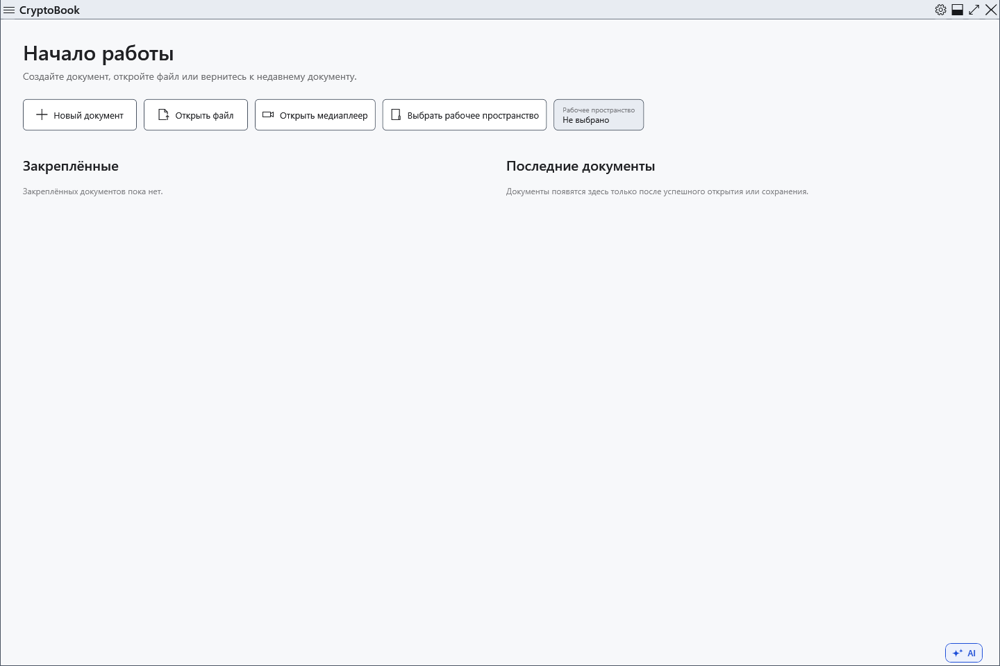

# Установка и запуск portable

CryptoBook работает в Windows 10 версии 1809 или новее, x64. Официальная поставка включает среду .NET; отдельно устанавливать Desktop Runtime для неё не требуется. Модели AI устанавливаются отдельно.

## Выберите способ запуска

1. Для обычной установки возьмите установщик `CryptoBook-Setup-<версия>.exe` из релизов проекта. Перед запуском сравните SHA-256 файла с записью в `SHA256SUMS.txt` того же выпуска; статус подписи указан в `SIGNING-STATUS.txt`.
2. Сохраните документы и закройте CryptoBook. Запустите установщик, подтвердите запрос Windows на повышение прав, выберите папку программы и при необходимости ярлык. Не храните личные документы внутри папки установки: при обновлении там заменяются и удаляются служебные файлы.
3. Для portable распакуйте **весь** `CryptoBook-win-x64.zip` в отдельную папку и запустите `CryptoBook.exe`. Не запускайте из ZIP и не переносите один exe без остальных файлов поставки.

Установщик регистрирует CryptoBook в «Открыть с помощью» Windows для `.cbook` и `.cbox`; выбор приложения по умолчанию остаётся за вами. Portable не выполняет эту регистрацию автоматически.

## Первый запуск и обновление

Откройте **Настройки** кнопкой в строке заголовка. Язык, тему и рабочую директорию можно выбрать без создания защищённого документа. Для шифрования потребуется собственный пароль; установка программы его не создаёт.

Portable использует профиль Windows для настроек, истории и восстановления, как установленная версия. Папка с exe не является полной переносимой копией ваших данных. Встроенная команда обновления запускает установщик; чтобы сохранить способ работы через ZIP, распакуйте новую поставку в новую папку и запускайте её оттуда после закрытия старой версии.

Если приложение не запускается, проверьте версию Windows, x64, полную распаковку и наличие свободного места в TEMP. Для неподписанного файла Windows может показать предупреждение; сначала проверьте источник, сумму и статус подписи. Не отключайте защиту Windows ради запуска неизвестного файла. Удалить установленную программу можно средствами Windows; пользовательские документы храните отдельно и резервируйте самостоятельно.

- [Параметры интерфейса](help:settings.appearance)
- [Обновление](help:settings.updates)
- [Пользовательские данные](help:settings.data)
