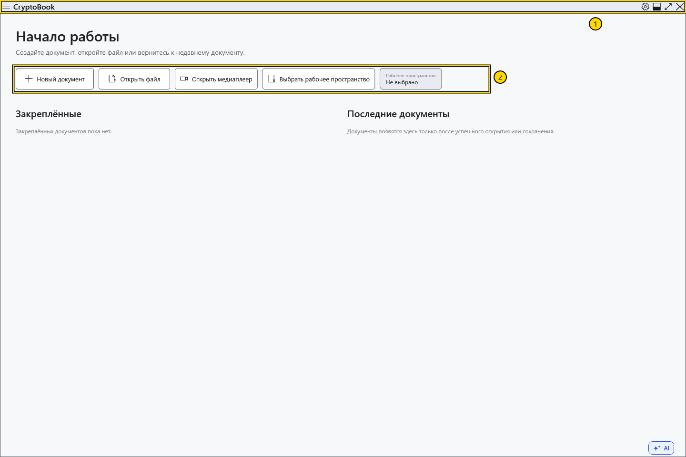
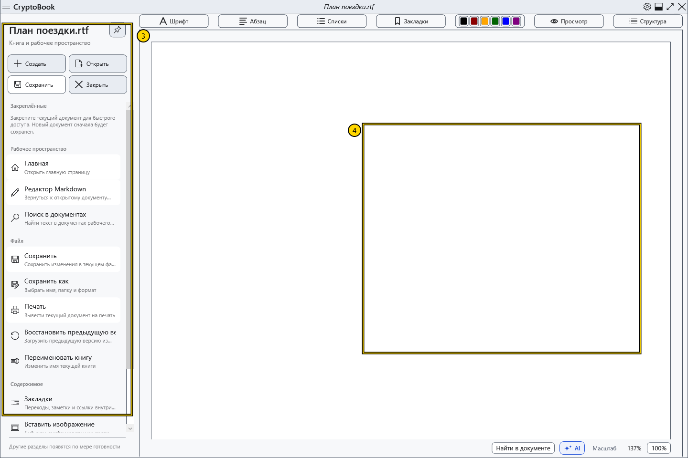
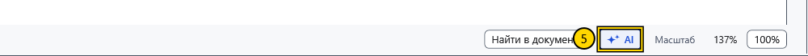

# Основные области окна

На начальном экране можно создать или открыть документ. После открытия документа центральная часть окна становится областью чтения и редактирования.

## Где что находится

1. **Верхняя строка.** Слева расположены стрелки назад и вперёд и кнопка меню с тремя горизонтальными линиями. Стрелки переключают страницы приложения. Посередине отображается имя документа. Шестерёнка справа открывает **Настройки**; рядом находятся кнопки управления окном.
2. **Начальный экран.** **Новый документ** открывает диалог создания, **Открыть файл** — выбор файла, **Выбрать рабочее пространство** — выбор папки для поиска по рабочему пространству. Здесь же видны закреплённые и недавние документы, если соответствующие списки заполнены.

3. **Боковое меню.** Откройте его кнопкой с тремя линиями. В быстрых действиях есть **Создать**, **Открыть**, **Сохранить** и **Закрыть**. Ниже команды сгруппированы в разделы **Рабочее пространство**, **Файл** и **Содержимое**. Открывайте меню, чтобы находить команды по инструкции.
4. **Область документа.** Над текстом обычного документа расположены панели форматирования. Для Markdown используется отдельный редактор. Переход между страницами не превращает один документ в другой; перед сохранением проверьте, какой редактор активен.

5. **Нижняя часть обычного редактора.** Здесь находятся поиск в документе, кнопка **AI-помощник** и управление масштабом. Панель помощника открывается справа, когда она доступна. Для работы помощника нужна отдельная настройка.

## Попробуйте

Откройте и закройте боковое меню, затем откройте **Настройки** шестерёнкой. Закройте окно настроек, чтобы вернуться к документу. Если пока виден начальный экран, создайте демонстрационный документ, чтобы увидеть элементы редактора.

## Первое знакомство и справка

При первом знакомстве начните с **Новый документ** или **Открыть файл**. Вид начальной страницы зависит от настройки запуска: вместо начального экрана может сразу показываться редактор. Рабочая директория нужна для поиска и не обязательна для отдельного документа.

Нажмите **F1** в главном окне или выберите **Справка** в боковом меню. Руководство открывается в отдельном окне: его можно читать, продолжая работу в редакторе. Выбор статьи не закрывает и не сохраняет документ. Закройте справку или активируйте главное окно, чтобы вернуться к работе.

## Связанные темы

- [Создать и сохранить документ](help:doc.create)
- [Выбрать рабочую директорию](help:start.workspace)
- [Два редактора, переименование и закрытие](help:doc.switch)
- [Начать работу с AI](help:ai.start)
