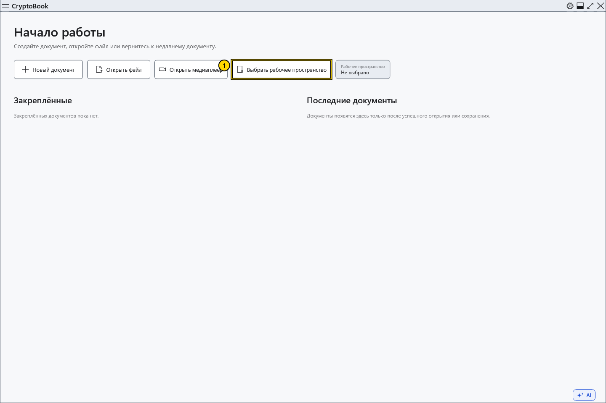
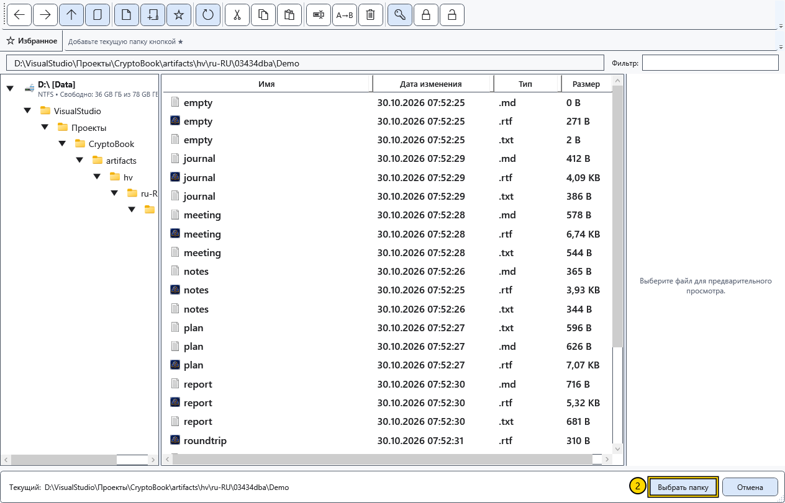
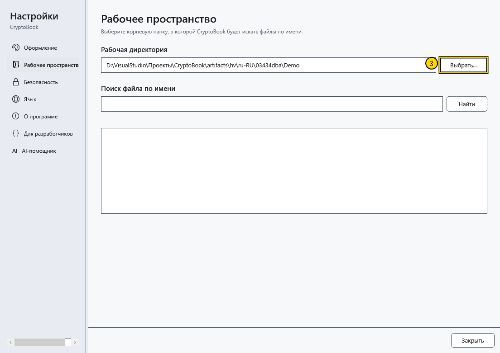

# Выбрать рабочую директорию

Рабочая директория задаёт папку для поиска документов. Например, выберите папку проекта, чтобы искать его файлы по имени или содержимому. Для создания или открытия отдельного документа выбирать рабочую директорию необязательно.

## Порядок действий

1. На начальном экране нажмите **Выбрать рабочее пространство**. Если открыт редактор, используйте шестерёнку **Настройки → Рабочее пространство → Выбрать...**.

2. В окне выбора перейдите в нужную локальную папку. Проверьте путь внизу и подтвердите выбор. **Отмена** оставляет прежнюю рабочую директорию.

3. Откройте **Настройки → Рабочее пространство** и проверьте показанный путь. Здесь находится **Поиск файла по имени**; поиск по содержимому открывается отдельной командой рабочего пространства.

## Три разных пути

| Путь | На что влияет |
| --- | --- |
| Рабочая директория | Область поиска по рабочему пространству |
| Текущая папка файлового менеджера | Список показываемых файлов и назначение файловых операций |
| Папка открытого документа | Расположение файла; **Сохранить** пишет именно в него |

Смена рабочей директории не перемещает открытый файл, не меняет его имя и не сохраняет его в новую папку. Для другого места сохранения используйте **Файл → Сохранить как**.

## Если не получилось

Если папка недоступна, подключите соответствующий диск или выберите существующую локальную папку. Пустой результат поиска не означает, что открытый документ удалён: сначала проверьте область поиска и имя. Сменить выбор можно той же кнопкой; ранее записанные файлы от этого не удаляются.

## Связанные темы

- [Основные области окна](help:start.interface)
- [Открыть документ](help:doc.open)
- [Сохранить и «Сохранить как»](help:doc.save)
- [Навигация по файлам](help:files.navigate)
- [Поиск по имени](help:search.name)
- [Поиск по содержимому](help:search.workspace)
