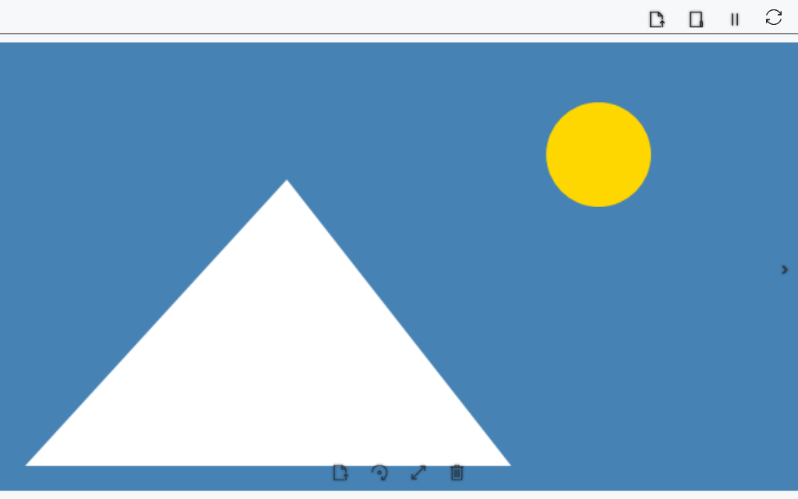

# Просмотр изображений в медиаплеере

Медиаплеер открывает изображение в отдельном окне. Поворот, масштаб и смещение относятся к просмотру. Для изменения файла используйте отдельное окно **Изменить изображение**.

## Перед началом

> **Удаляется исходный файл, включая сам .cbook/.cbox, а не расшифрованная копия.** Сначала проверяются объём исходника и свободный лимит корзины. Если места достаточно, плеер запрашивает перенос в корзину Windows. Если корзины нет или места недостаточно, он предлагает безвозвратное удаление и ждёт отдельного согласия. До подтверждения ничего не удаляется.

Используйте локальный файл или локальную копию с устройства. Возможность декодирования формата зависит от Windows.

## Порядок действий

1. Откройте **Содержимое → Фото и видео**, затем **Открыть в этом плеере** и выберите изображение. Кнопка **Открыть в новом плеере** открывает выбранный файл в другом окне.
2. Кнопки **Предыдущее изображение** / **Следующее изображение** и клавиши ←/→ переходят между изображениями выбранного каталога; на краях списка переход недоступен.
3. Используйте **Повернуть** для поворота. Колесо и клавиши ↑/↓ увеличивают/уменьшают масштаб; перетаскивание левой кнопкой смещает изображение.
4. Нажмите **Вписать изображение**, чтобы сбросить поворот, масштаб и смещение.
5. Чтобы удалить файл, нажмите **Удалить изображение** или Delete. Дождитесь проверки корзины, проверьте путь исходника и способ удаления в предупреждении. Нажмите **ОК** для указанного действия либо **Отмена**, чтобы сохранить файл. Пока операция выполняется, повторное удаление и переход к другому изображению недоступны. Прогресс закрывается после открытия соседнего изображения или очистки просмотра.

## Изменение и сохранение

1. Нажмите **Изменить изображение** (значок карандаша на панели изображения).
2. Настройте **Контрастность**, **Яркость** и **Насыщенность** от −100 до 100. Предпросмотр обновляется автоматически; исходный файл пока не меняется.
3. Укажите ширину и высоту в пикселях. Опция **Сохранять пропорции** включена по умолчанию: изменение одной стороны пересчитывает другую по исходным пропорциям. Отключите её для независимых размеров. Допустимо от 1 до 32768 пикселей на сторону и не более 100 мегапикселей.
4. **Сбросить** возвращает исходные размеры и нейтральные настройки цвета. **Отмена** закрывает редактор без записи изменений.
5. Нажмите **Сохранить как**, выберите путь и формат PNG, JPEG, BMP или TIFF. Для замены исходника выберите тот же путь и подтвердите замену. После сохранения плеер открывает результат.

Запись выполняется через временный файл в выбранной папке с последующей атомарной заменой: при ошибке записи или отмене до замены существующий файл сохраняется. При ошибке окно остаётся открытым для повторной попытки. Во время сохранения отмена запрашивает остановку; окно ждёт завершения текущего этапа записи.

Сохраняется один кадр, без метаданных исходника; анимация и многостраничность не переносятся. PNG и TIFF сохраняют прозрачность; JPEG и BMP заменяют её белым фоном. GIF, ICO и WebP можно преобразовать в один из предлагаемых форматов. Для .cbook/.cbox сохраняется **незашифрованная копия**, исходный защищённый контейнер не заменяется. Поворот и масштаб из окна просмотра не входят в настройки редактора.

## Проверка результата

Картинка отображается в окне. Элементы управления появляются при наведении; названия доступны в подсказках. Стрелки без модификаторов относятся к изображению при активном окне плеера. После переноса файла в корзину плеер показывает соседнее изображение; если изображений больше нет, область просмотра очищается.

## Отмена и возврат

В запросе удаления выберите **Отмена**, чтобы сохранить исходник. Закрытие плеера отменяет ещё не выполненную часть операции. После переноса в корзину откройте её, выберите файл и нажмите **Восстановить**, затем снова откройте файл в плеере. После подтверждённого безвозвратного удаления восстановление из корзины невозможно.

## Если не получилось

Нет соседнего изображения — проверьте выбранный каталог и порядок файлов. При ошибке декодирования попробуйте поддерживаемый формат; PDF и видео относятся к другим способам просмотра.

Если лимит корзины определить не удалось, операция останавливается с сообщением. При отказе от подтверждения или ошибке до удаления исходник и текущее изображение сохраняются. Если файл уже успешно удалён к моменту отмены, плеер переходит к соседнему изображению; отмена не возвращает уже удалённый файл автоматически.

## Связанные темы

- [Видео и несколько окон плеера](help:view.video)
- [Открытие, переименование и удаление](help:files.manage)
