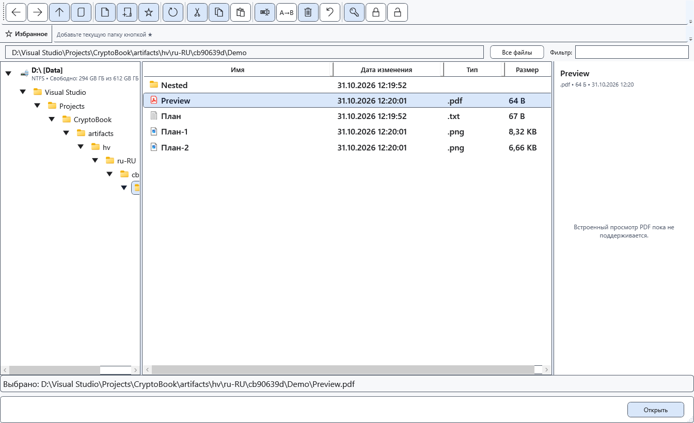

# Открытие PDF

CryptoBook направляет обычный PDF во внешнюю программу Windows. PDF не становится редактируемым документом CryptoBook, и встроенная правая панель не отображает его страницы.

## Перед началом

Нужно установленное приложение для PDF и настроенная ассоциация Windows. Для файла на Android сначала создайте локальную копию. Не передавайте защищённый контейнер внешней программе как обычный PDF.

## Порядок действий

1. Откройте файловый менеджер и выберите локальный PDF. Справа появится сообщение об отсутствии встроенного просмотра PDF.
2. Откройте файл обычной командой **Открыть**. Windows запустит приложение, назначенное для PDF.
3. Читайте, печатайте или редактируйте PDF средствами той программы. Для возврата активируйте окно CryptoBook.

## Проверка результата

Документ появляется во внешней программе, если ассоциация доступна. Содержимое обычного редактора CryptoBook не заменяется страницами PDF.

## Отмена и возврат

Закройте внешнее окно или вернитесь в CryptoBook. Если внешняя программа предлагает сохранить собственные изменения, решение относится к ней.

## Если не получилось

Если открытие не удалось, настройте приложение по умолчанию для PDF в Windows и повторите. Не переименовывайте расширение ради редактирования в CryptoBook. Защищённый PDF сначала явно расшифруйте в выбранное безопасное место; полученный файл будет незашифрованным.

## Связанные темы

- [Открыть документ](help:doc.open)
- [Форматы и кодировки](help:doc.formats)
