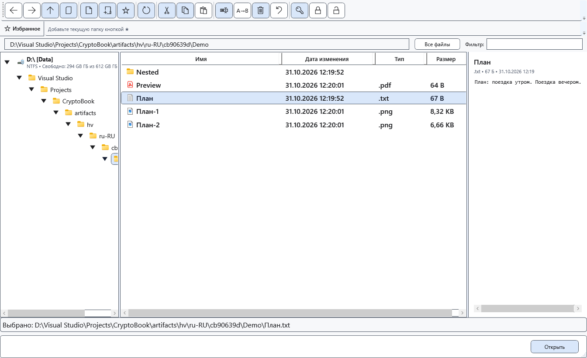
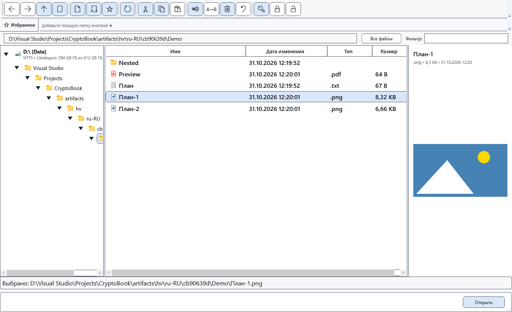

# Предпросмотр в файловом менеджере

Правая панель файлового менеджера позволяет быстро прочитать текст или посмотреть изображение, не открывая отдельный редактор.

## Перед началом

Для просмотра достаточно одного выбранного файла. Для локального защищённого файла нужен уже введённый подходящий ключ. Просмотр на Android читает исходный поток и не расшифровывает его автоматически.

## Порядок действий

1. Откройте файловый менеджер и перейдите в папку.
2. Выберите один файл в списке. В правой панели проверьте имя, тип, размер и содержимое либо сообщение об ограничении.
3. Выберите другой файл, чтобы сменить просмотр. Для редактирования или полного просмотра откройте файл подходящей командой.

## Проверка результата

Текст показывается для TXT, LOG, MD, CS, XAML, JSON, XML, YAML/YML, INI, CONFIG, CSV и TSV. Читаются первые 512 КиБ. Изображения PNG, JPG/JPEG, BMP, GIF и WEBP ограничены 32 МиБ; декодирование зависит от поддержки Windows. Это не полный просмотр RTF или PDF.

## Отмена и возврат

Выберите папку, другой файл либо закройте окно. Предпросмотр не записывает изменения в файл.

## Если не получилось

Слишком большой файл, неподдерживаемый формат, неверный ключ или отключённое устройство дают сообщение вместо содержимого. Локальный защищённый предпросмотр ограничен 32 МиБ и поддерживаемым содержимым. Для удалённого защищённого файла сначала выполните явное расшифрование либо скопируйте его локально.

## Связанные темы

- [Навигация по папкам](help:files.navigate)
- [Возможности и ограничения устройств](help:devices.limits)
- [Просмотр изображений в медиаплеере](help:view.images)
