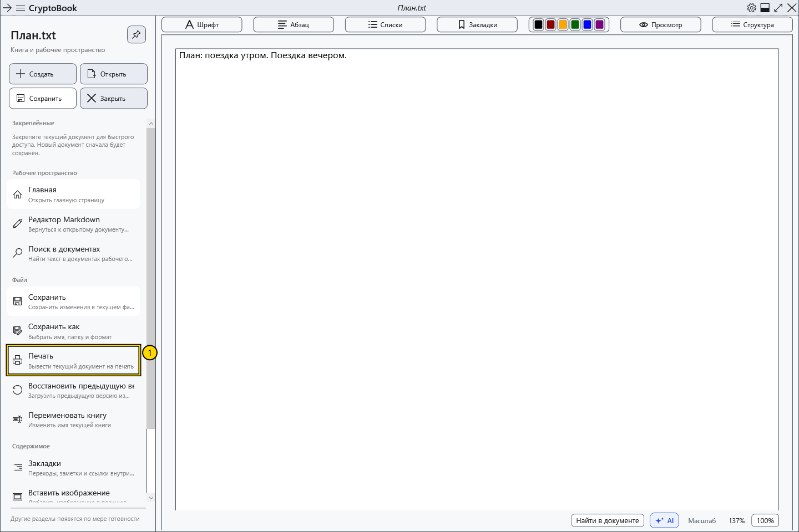

# Печать текущего документа

Команда печати передаёт текущий документ системному диалогу. Обычный документ печатается с оформлением, Markdown предварительно преобразуется в отображаемый документ.

## Перед началом

Активируйте нужный обычный документ или Markdown; в нём должно быть непустое печатаемое содержимое. Проверьте выбранный принтер, бумагу и доступность устройства. Печать может раскрыть защищённое содержимое на бумаге или в выходном файле.

## Порядок действий

1. В боковом меню выберите **Файл → Печать**.
2. В системном диалоге Windows выберите принтер и его доступные параметры. Язык и набор полей зависят от Windows и драйвера.
3. Проверьте назначение и подтвердите печать либо нажмите отмену в системном диалоге.

## Проверка результата

После подтверждения задание передаётся выбранному принтеру. Размер печатной области определяется принтером и может отличаться от экранного вида. Печатается активный документ целиком; выделение текста само по себе не ограничивает объём. Для PDF используйте печать внешнего просмотрщика.

## Отмена и возврат

Отмена до подтверждения не отправляет задание. После отправки проверяйте очередь печати Windows или панель принтера; закрытие CryptoBook не гарантирует отмены задания.

## Если не получилось

Команда недоступна — проверьте наличие документа и содержимого. Ошибка печати — проверьте драйвер, очередь и связь с принтером. Предпросмотр на экране не подтверждает физическую печать и точное совпадение разметки на бумаге.

## Связанные темы

- [Параметры и цвет страницы](help:edit.page)
- [Просмотр, страницы и масштаб](help:edit.view)
