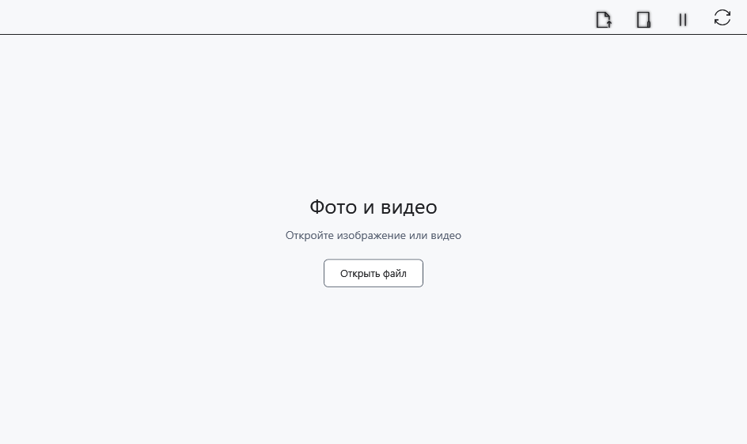

# Видео и несколько окон плеера

Медиаплеер открывает видео в отдельном окне. Поддержка конкретного файла зависит от контейнера, кодека и доступного декодирования; расширение само по себе не гарантирует воспроизведение.

## Перед началом

Используйте локальное видео или локальную копию с устройства. Окно доступно через **Содержимое → Фото и видео** и кнопку на начальной странице.

## Порядок действий

1. Нажмите **Открыть в этом плеере** и выберите видео. **Открыть в новом плеере** открывает выбранный файл в другом окне.
2. В области видео используйте элементы Flyleaf: воспроизведение/пауза, шкала времени и звук. Наведите указатель, если панель скрыта.
3. При фокусе в области видео ←/→ служат перемотке; Alt+←/→ переходят к предыдущему/следующему видео каталога, если оно есть.
4. **Приостановить все плееры** приостанавливает плееры. **Синхронизировать воспроизведение (экспериментально)** включает экспериментальную связь нескольких окон; отключите её для независимого управления.

## Проверка результата

При успешном открытии виден видеокадр и движется позиция воспроизведения. Переход к соседнему видео использует выбранный каталог, а не все видео компьютера. Для нескольких окон синхронизация не обещает точного покадрового совпадения.

## Отмена и возврат

Поставьте на паузу, откройте другой файл либо закройте окно. Закрытие плеера не удаляет видео. Отключение синхронизации возвращает независимое управление.

## Если не получилось

Нет кадра или есть сообщение об ошибке — проверьте файл локально, его целостность и поддержку кодека. Клавиши действуют по фокусу; не переносите сочетания текстового редактора на Flyleaf. Шкала и дополнительные команды могут иметь оформление самого плеера.

## Связанные темы

- [Просмотр изображений в медиаплеере](help:view.images)
- [Возможности и ограничения устройств](help:devices.limits)
