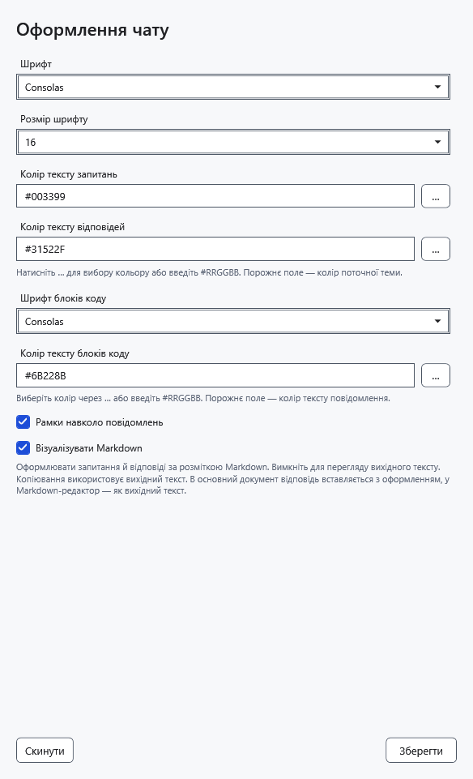
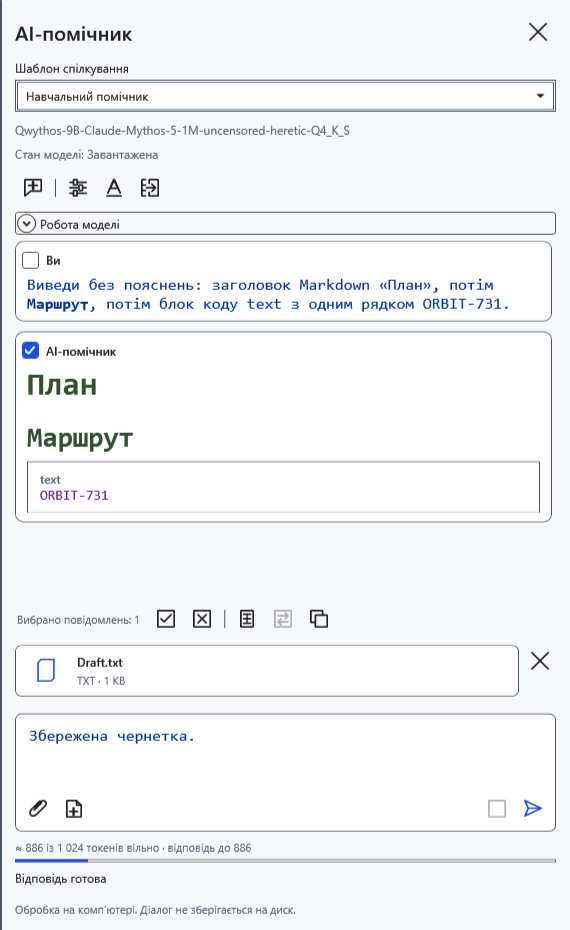
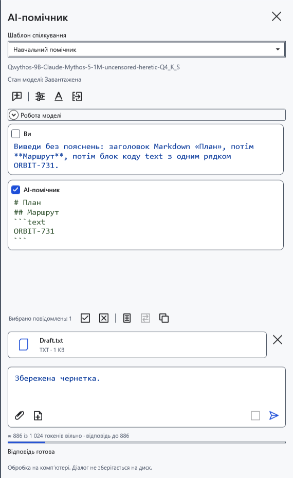
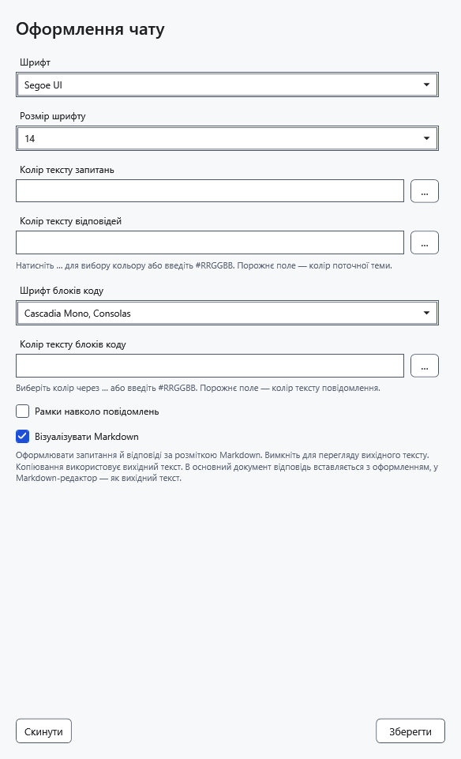

# Оформлення чату AI

Шрифти, кольори й Markdown змінюють відображення чату, зберігаючи початкову відповідь, листування, чернетку та вкладення. Налаштування оформлення спільні для моделей. Їх збереження не вивантажує модель і не зупиняє поточну відповідь.

## Змінити оформлення

1. Угорі панелі помічника натисніть **Оформлення чату** — значок A.
2. Виберіть **Шрифт** і **Розмір шрифту** від 8 до 40. Вони діють для повідомлень, поля запитання й міркувань. Блоки коду мають окремий шрифт.
3. Задайте кольори запитань, відповідей і коду у форматі **#RRGGBB**, наприклад `#31522F`. Кнопка кольору відкриває системний діалог. Порожнє поле використовує колір теми; порожній колір коду успадковує колір відповідного повідомлення.
4. За потреби ввімкніть **Рамки навколо повідомлень**. Типово вони вимкнені.

5. Натисніть **Зберегти**. Уже отримані відповіді перемалюються з вибраними параметрами.

## Markdown і початковий текст

**Візуалізувати Markdown** типово ввімкнено: заголовки, списки, таблиці й код відображаються оформленими. Вимкніть прапорець і збережіть, щоб бачити початковий Markdown зі знаками розмітки.

**Копіювати** бере початковий текст відповіді в обох режимах. Прапорець не керує оформленим перенесенням у звичайний редактор — воно має власні правила. HTML не виконується, зовнішні зображення Markdown не завантажуються. Оформлення не робить згенерований код безпечним для запуску.

## Скинути й відкинути

6. Відкрийте вікно й натисніть **Скинути**: з’являться типові параметри — розмір 14, без рамок, із Markdown і кольорами теми. Натисніть **Зберегти**, щоб застосувати їх.

Закриття вікна без збереження відкидає зміни, зокрема скидання. Якщо колір неправильний, виправте його або очистьте поле й збережіть знову. Якщо шрифту немає в списку, виберіть установлений. Дрібний текст збільште через розмір шрифту; ці параметри не змінюють текст документа.

- [Чат і копіювання](help:ai.chat)
- [Перенесення відповіді в документ](help:ai.apply)
- [Загальний вигляд застосунку](help:settings.appearance)
