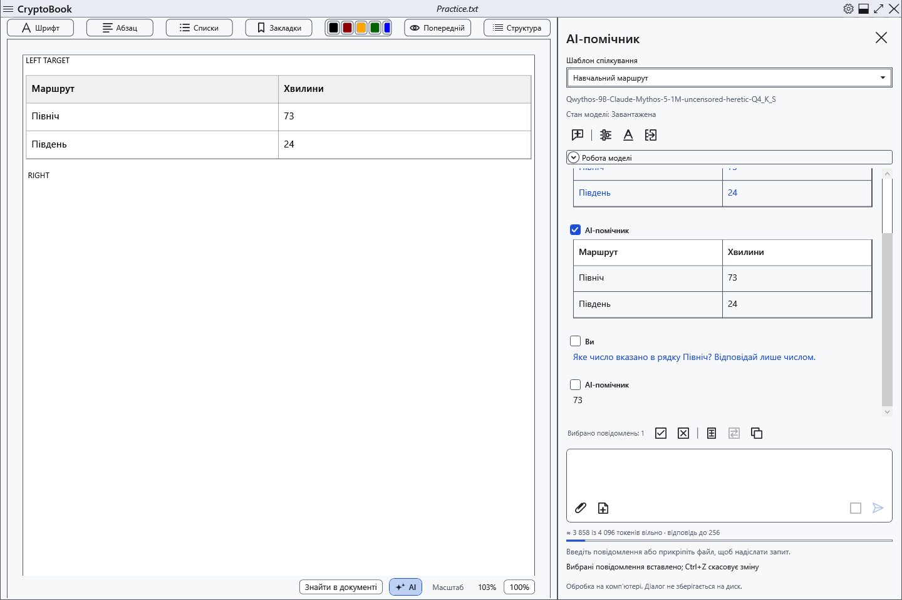
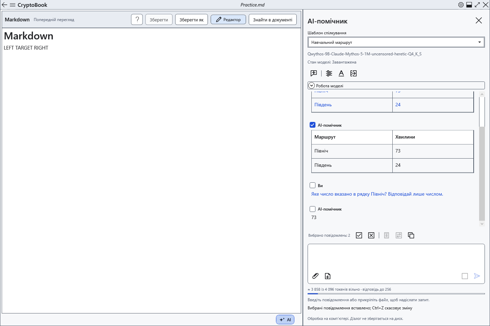
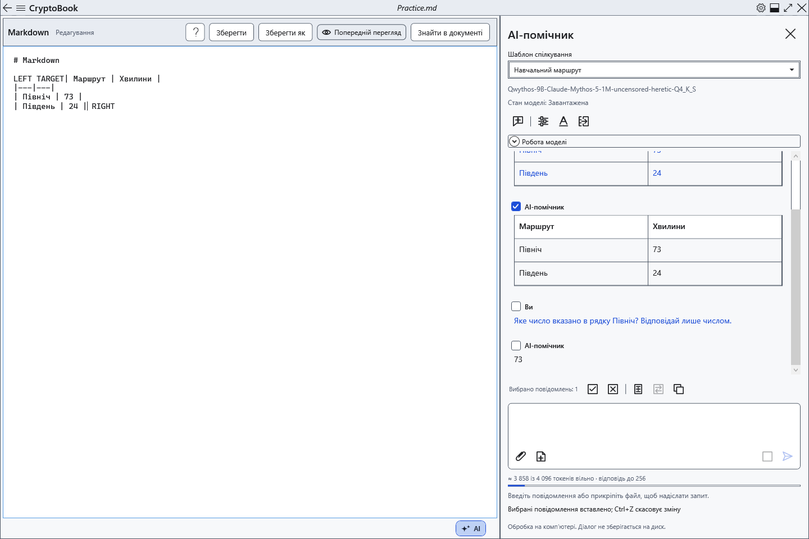

# Перенести відповіді в документ

**Вставити вибране** й **Замінити виділення** переносять позначені повідомлення з чату в поточний редактор. Документ, курсор і виділення можна вибрати після отримання відповіді. Перевірте текст моделі перед перенесенням.

## Звичайний редактор

1. Позначте потрібні повідомлення в AI-панелі. Одне переноситься без доданого підпису; кілька — у порядку діалогу, з підписами учасників і роздільниками. Міркування та вміст вкладень не переносяться.
2. Відкрийте звичайний документ для редагування. Поставте курсор або виділіть текст.
3. Натисніть **Вставити вибране**: відповідь з’явиться в позиції курсора, а за наявності виділення — після нього. Виділений текст збережеться.

4. Для заміни спочатку перевірте виділення: команда видалить саме його. Натисніть **Замінити виділення**. Без виділення вона недоступна.

Звичайний редактор перетворює Markdown на редаговані заголовки, виділення, списки, код і таблиці. Клітинки можна виправляти окремо; це не змінює початкову відповідь у чаті. Повторне вставлення залишається доступним і додає вміст ще раз. HTML неактивний; картинки з розмітки AI не завантажуються. Файли-картинки вставляйте засобами редактора.

## Markdown

5. Перейдіть до потрібного Markdown-документа. Якщо відкрито **Попередній перегляд**, натисніть **Редактор**. Із перегляду обидві команди перенесення недоступні.

6. У вихідному тексті поставте курсор/виділення й натисніть ту саму команду. Вставляється вихідний Markdown вибраних повідомлень, а не оформлений WPF-фрагмент. Перейдіть у **Попередній перегляд**, щоб перевірити результат.

Перенесення рядків автоматично не додаються. Для окремої таблиці чи заголовка підготуйте межі блоку у вихідному тексті: вставлення посеред рядка може залишити розмітку звичайним текстом.

## Перевірити, скасувати та зберегти

Команди змінюють документ у пам’яті без автоматичного запису файлу. Перевірте місце вставлення й навколишній текст. Один Ctrl+Z у відповідному редакторі скасовує все вставлення або заміну, Ctrl+Y повторює. Потім збережіть звичайним способом. Для збереження оформлення звичайного документа виберіть відповідний формат; TXT залишає лише текст.

За відсутності позначок виберіть повідомлення. Якщо вставлення недоступне, відкрийте редагований документ, вийдіть із перегляду/режиму читання та дочекайтеся завершення відповіді. Блокування забороняє перенесення. Якщо документ змінився під час застосування, прочитайте помилку й перевірте ціль знову: не покладайтеся на старий курсор іншого документа.

- [Вибір повідомлень](help:ai.chat)
- [Таблиці документа](help:content.tables)
- [Редагування Markdown](help:md.edit)
- [Формати документів](help:doc.formats)
- [Збереження](help:doc.save)
