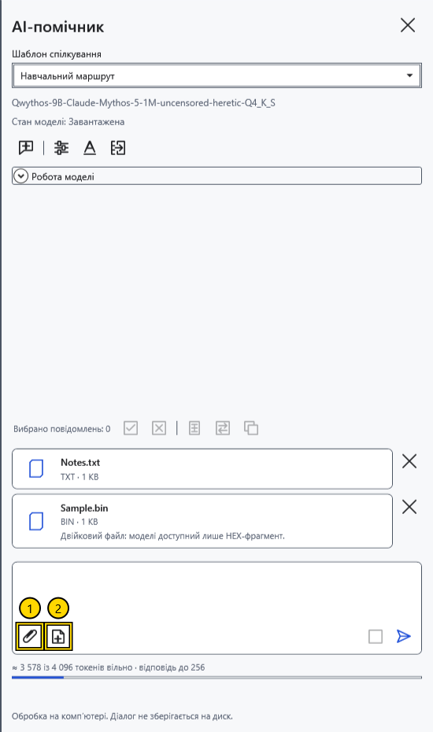
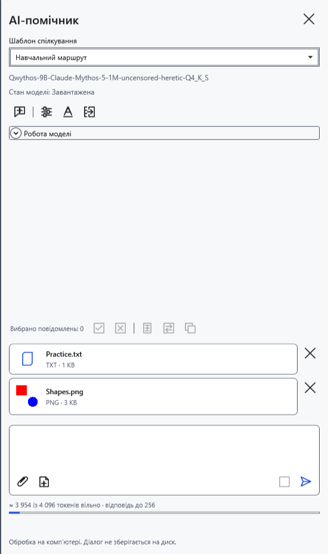
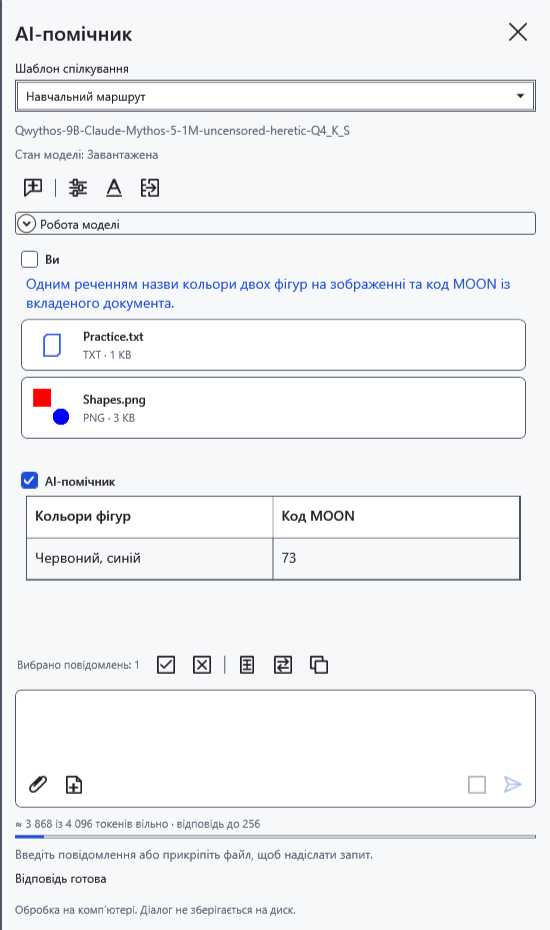
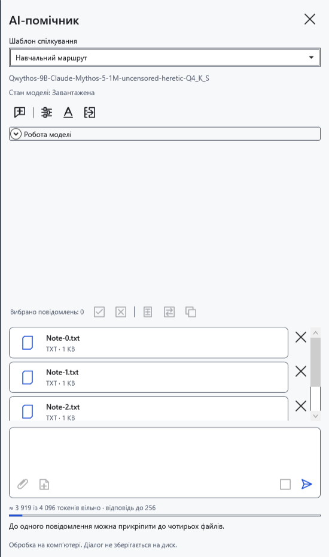

# Прикріпити файли та поточний документ

Вкладення додають відомості до запитання. Вибирайте файли, які маєте намір передати локальній моделі. Картка файлу не означає, що програма змогла витягти весь його вміст.

## Додати та прибрати

1. Натисніть **Прикріпити файли…** (1) біля поля запиту. Системний вибір пропонує документи/зображення та **Усі файли (*.*)**. Можна вибрати кілька файлів або перетягнути їх на панель.
2. Перевірте картки. До надсилання хрестик **Прибрати вкладення** видаляє відповідну картку.

Текст, Markdown, RTF, DOCX та XamlPackage передаються як витягнутий текст. Оформлення й вбудовані картинки документа не стають зображеннями для vision. Для невідомого розширення програма намагається прочитати текст; двійковий файл отримує обмежений HEX-перегляд перших 256 байтів разом з іменем і розміром. Це не повний розбір PDF, архіву чи іншого двійкового формату. Для захищеного документа спочатку відкрийте його звичайним способом і використайте знімок поточного документа.

## Прикласти документ і зображення

3. Відкрийте потрібний документ і натисніть **Поточний документ** (2). Додається текст усього документа на цей момент, зокрема незбережені правки, а не лише виділення. У Markdown це вихідний текст. Подальше редагування не оновлює створену картку: приберіть її та прикладіть знову.
4. Для картинки прикріпіть окремий PNG/JPEG/BMP/GIF/TIFF. Потрібні модель із підтримкою зору та рівно один сумісний mmproj поруч із GGUF.

5. Введіть запитання й натисніть **Надіслати**. Без тексту запитання використовується стандартний запит про файли. Надіслані картки переходять в історію; уточнення того самого чату використовують попередні вкладення.

## Обмеження та помилки

До одного повідомлення — до чотирьох файлів; окремий файл — до 32 МБ; витягнутий текст — до 500000 символів; зображення до зменшення — до 100 мегапікселів. Програма зменшує великі картинки для обробки; дрібні деталі можуть втрачатися. Вкладення та історія займають контекст моделі: допустимий файл усе одно може не вміститися в конкретний запит.

Після помилки ліміту попередні картки залишаються: приберіть зайве й повторіть. Порожній/завеликий файл, помилка читання або пошкоджена картинка не додаються. Під час читання файлів чи відповіді дочекайтеся завершення. Окремо прибрати вже надісланий файл з історії не можна; **Новий чат** видаляє все листування, чернетку та вкладення без архівування. Спочатку збережіть потрібні відповіді. Закриття програми й скидання ключа також видаляють вкладення.

- [Чат](help:ai.chat)
- [Модель і vision-проєктор](help:ai.models)
- [Перенесення відповіді](help:ai.apply)
- [Помилки помічника](help:ai.troubleshoot)
- [Контекст](help:ai.context)
