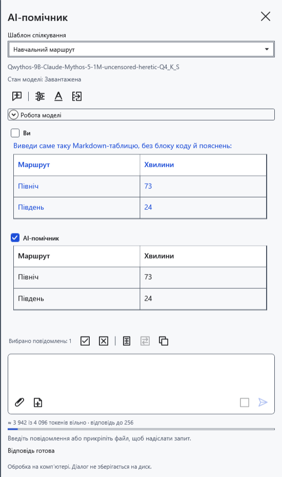
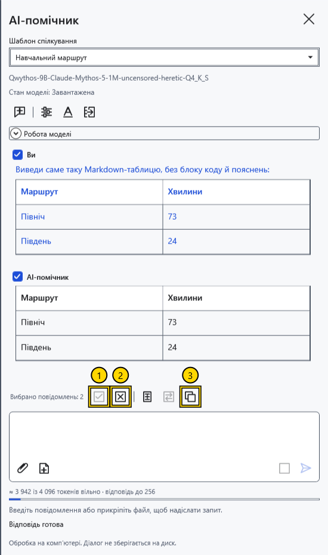
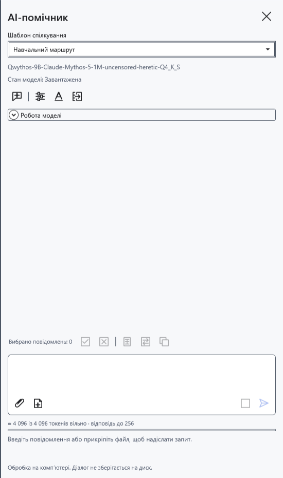

# Спілкуватися з помічником і вибирати повідомлення

Чат розташований у правій AI-панелі. Запитання, відповіді й надіслані вкладення утворюють поточну історію для наступних запитів. Позначки повідомлень керують копіюванням і перенесенням у редактор; непозначені повідомлення залишаються в контексті моделі.

## Надіслати запитання

1. Увімкніть помічника й виберіть модель. Введіть запитання внизу панелі.
2. Натисніть **Надіслати** або Ctrl+Enter у полі вводу. Звичайний Enter додає рядок. Під час відповіді дочекайтеся завершення або натисніть **Зупинити**.
3. Прочитайте відповідь і перевірте факти. Поставте уточнення в тому самому чаті, щоб використати попереднє листування.

Відповідь з’являється поступово. Якщо модель видає окремі міркування, їх можна розкрити в **Міркування моделі**; вони відокремлені від підсумкового тексту. За порожньої відповіді прочитайте повідомлення стану. Налаштування міркувань залежать від моделі.

## Вибрати та скопіювати

Позначте прапорці біля **Ви** та **AI-помічник**. Можна вибрати запитання, відповідь або кілька повідомлень. До ручної зміни вибору автоматично позначається остання непорожня відповідь; ручні позначки зберігаються під час наступного запиту.

1. **Вибрати все** позначає всі повідомлення з непорожнім текстом.
2. **Зняти вибір** прибирає позначки й вимикає копіювання та перенесення.
3. **Копіювати** поміщає вихідний текст вибраних повідомлень у буфер обміну.

Одне повідомлення копіюється без доданого підпису. Кілька йдуть у порядку діалогу, з підписами учасників і роздільниками. Вихідний Markdown зберігається, навіть якщо чат показує оформлену таблицю. Міркування та вміст вкладень не копіюються. **Вставити вибране** й **Замінити виділення** використовують той самий вибір.

## Почати заново

Перед **Новий чат** перенесіть потрібні відповіді в документ: команда без архівування видаляє листування, чернетку, вкладення, позначки та обчислювальний кеш. Завантажені ваги моделі залишаються в пам’яті; приховування панелі також не архівує чат. Листування не зберігається між запусками й очищається під час скидання ключа.

Якщо копіювання не вдалося, перевірте повідомлення стану й повторіть команду. За недоступного надсилання прочитайте пояснення під запитом.

- [Увімкнути помічника](help:ai.start)
- [Шаблони спілкування](help:ai.templates)
- [Вкладення](help:ai.attachments)
- [Перенести відповідь у документ](help:ai.apply)
- [Зупинка й вивантаження](help:ai.lifecycle)
