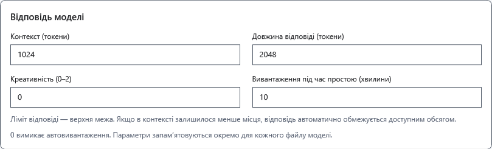
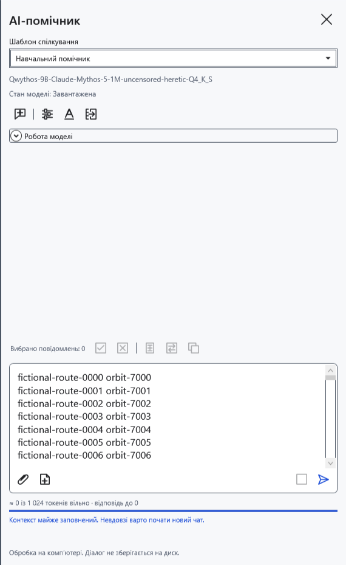
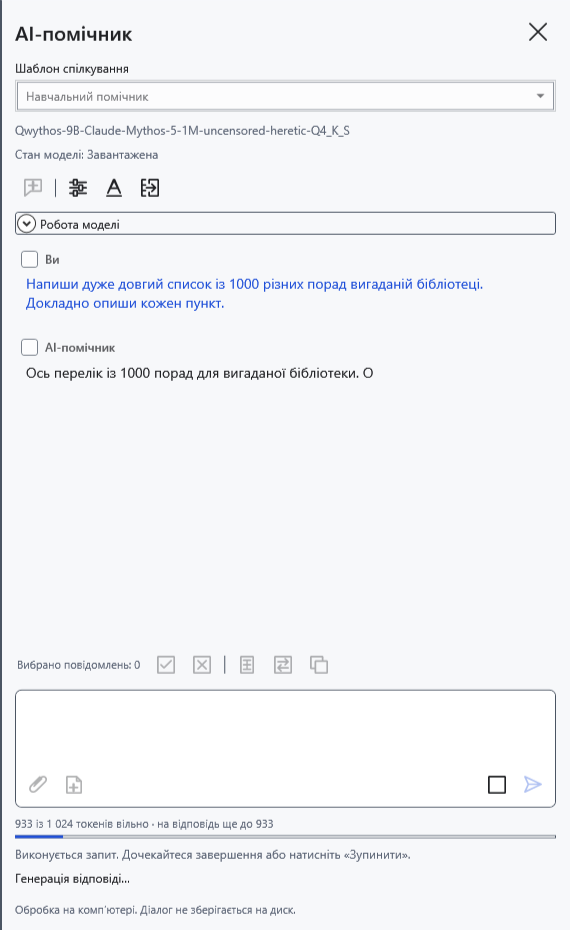
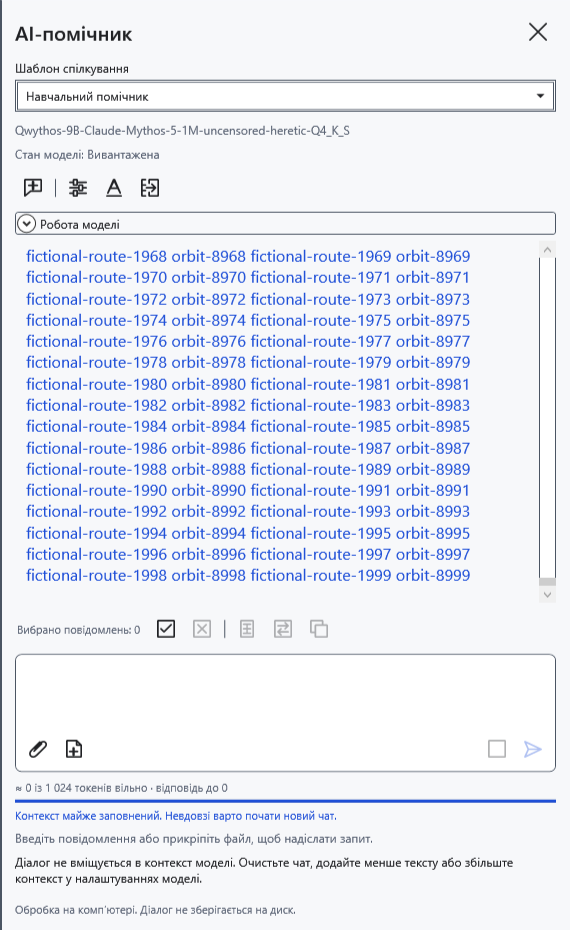
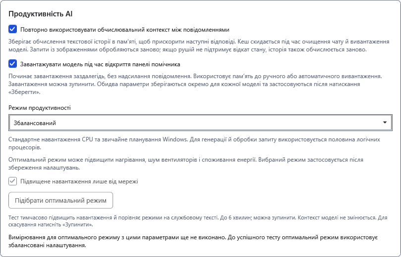
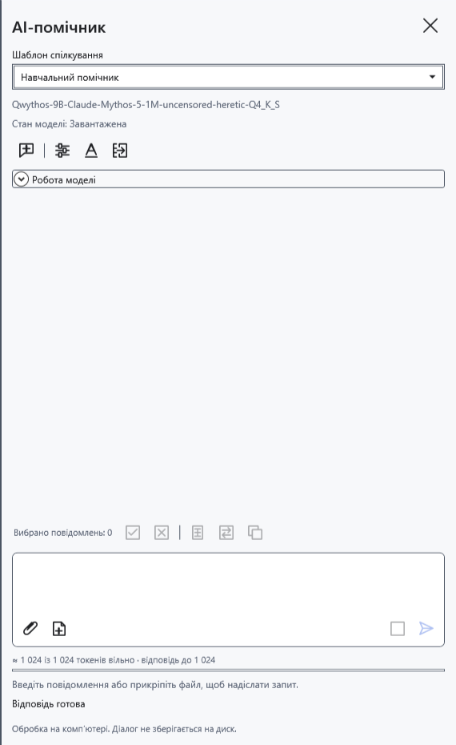

# Контекст, межа відповіді й попереднє завантаження

Контекст — спільне вікно токенів для інструкцій шаблону, історії, запитання, вкладень і нової відповіді, зокрема міркувань. Токен не дорівнює символу чи слову. Для довгої відповіді доступний лише вільний залишок вікна.

## Установити межі

1. Відкрийте **Налаштування моделі**, виберіть потрібний GGUF і прокрутіть до параметрів відповіді.
2. Задайте **Контекст (токени)**: 512–131072, у межах можливостей моделі й пам’яті комп’ютера. Більше значення потребує більше пам’яті та не покращує модель автоматично.
3. Задайте **Довжина відповіді (токени)**: 1–131072. Це верхня межа, а не вимога точної кількості тексту. Вона може перевищувати контекст, але справжня відповідь обмежена його вільним залишком. Модель також може завершити раніше.
4. **Креативність (0–2)** впливає на вибір продовження, а не регулює швидкість. Натисніть **Зберегти**. Зміна параметрів відповіді починає новий чат: спершу скопіюйте потрібний текст.

Параметри відповіді зберігаються окремо для кожного файла моделі. Шаблони спілкування спільні: перемикання шаблону не створює нової моделі.

## Читати індикатор

До надсилання та після завершення відповіді знак **≈** означає оцінку. Вона враховує поточну чернетку й вкладення, але може відрізнятися від розбиття токенізатором моделі. Порожній новий чат показує все вільне вікно, хоча майбутні інструкції теж займуть місце.

Під час генерації індикатор використовує справжні дані рушія: вхідні й уже видані токени, зокрема міркування. Залишок для відповіді зменшується під час генерації. Якщо автоматичний режим пам’яті зменшив контекст, чинний розмір видно в **Робота моделі**, а не лише в збереженому полі налаштування.

Якщо справжній запит не вміщується, з’являється повідомлення про заповнений контекст. Оцінка не гарантує успішного надсилання. Зменште запитання/вкладення або почніть **Новий чат**. Він без архівування видаляє листування, чернетку й вкладення та очищає обчислювальний кеш, зберігаючи завантажені ваги. Спершу скопіюйте потрібні відповіді.

## Повторне використання й попереднє завантаження

У **Налаштування моделі → Продуктивність AI** є два незалежні прапорці. Обидва типово вимкнені й діють після **Зберегти** окремо для вибраної моделі.

- **Повторно використовувати обчислювальний контекст між повідомленнями** зберігає обчислення однакового текстового початку наступного запиту. Виграш залежить від моделі та збігу початку; зміна інструкцій або ранньої репліки може вимагати перерахунку. Якщо рушій не підтримує відкат стану цієї моделі, історія теж обчислюється знову. Зображення обробляються знову. Це не збільшення контексту, не довготривала пам’ять і не архів чатів. Новий чат і вивантаження очищають кеш.
- **Завантажувати модель під час відкриття панелі помічника** переносить завантаження ваг на відкриття панелі. Запитання не надсилається, але пам’ять уже зайнята. За потреби зупиніть завантаження або вивантажте модель. Наступне відкриття панелі може знову почати завантаження.

До збереження натисніть **Скасувати** або закрийте вікно, щоб відкинути зміни. Для повернення вимкніть прапорці й збережіть; для негайного звільнення пам’яті натисніть **Вивантажити модель**. Закриття панелі зазвичай зберігає ваги.

- [Чат і нове запитання](help:ai.chat)
- [Режими пам’яті](help:ai.memory)
- [Завантаження й вивантаження](help:ai.lifecycle)
- [Шаблони спілкування](help:ai.templates)
