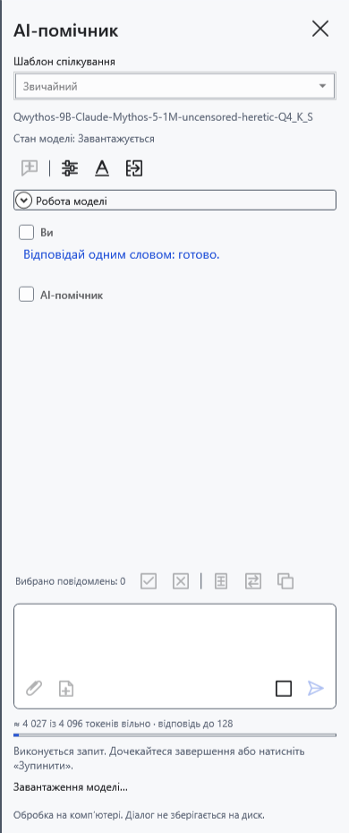
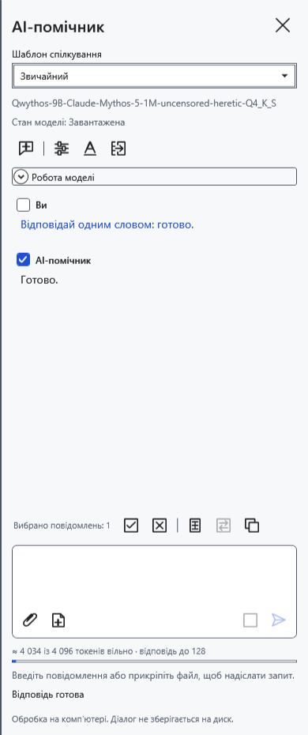
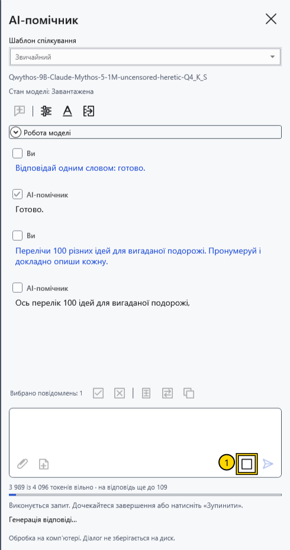
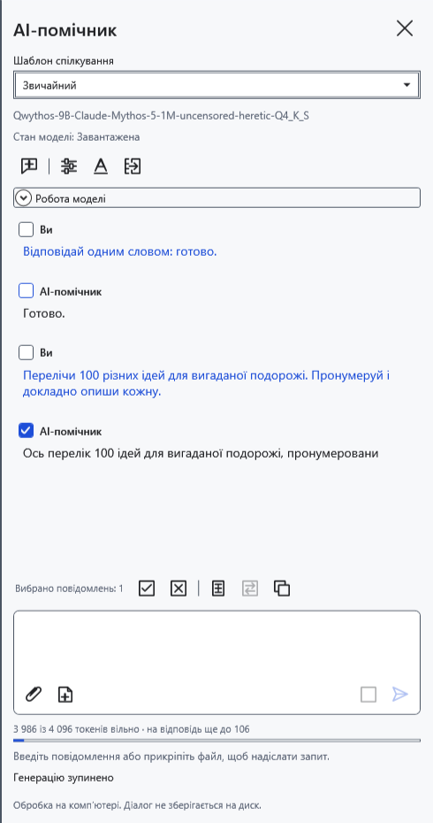
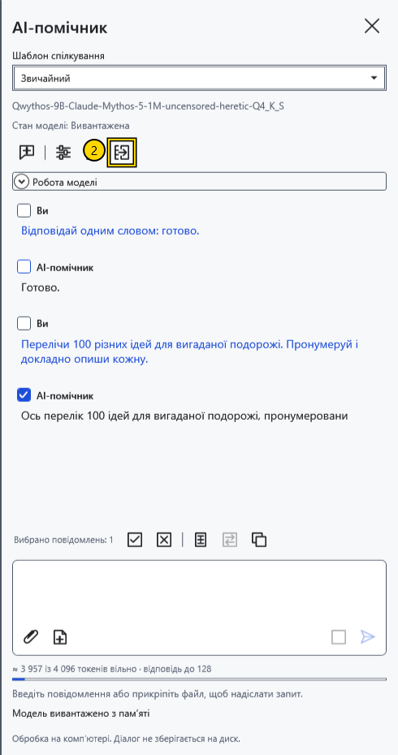

# Завантаження, зупинка й вивантаження моделі

**Стан моделі** під її назвою показує стан ваг. Перебіг операції та помилки відображаються окремо. **Завантажена** не означає, що відповідь іще генерується: модель може просто чекати наступного запиту.

## Завантаження та завершення відповіді

Виберіть і збережіть модель, потім надішліть запитання. Зазвичай перший запит завантажує ваги. Якщо ввімкнено **Завантажувати модель під час відкриття панелі помічника**, завантаження починається вже з відкриттям панелі. Під час завантаження й відповіді пам’ять і процесор можуть бути зайняті.

Дочекайтеся завершення відповіді. **Надіслати** знову стане доступною після введення наступного запитання, а ваги залишаться завантаженими для продовження.

## Зупинити поточну відповідь

1. Під час генерації натисніть **Зупинити** (1) біля поля запиту.

Дочекайтеся завершення зупинки. Отриманий текст залишається в чаті й може обриватися посеред речення. Звичайна узгоджена зупинка зберігає ваги. Скасування початкового завантаження натомість звільняє модель. Якщо окремий процес моделі не підтверджує зупинку приблизно за п’ять секунд, CryptoBook завершує його примусово; наступний запит завантажуватиме модель знову.

## Звільнити пам’ять

2. Натисніть **Вивантажити модель** (2) угорі панелі. Це скасовує поточну роботу й звільняє мовну модель і vision-проєктор. Дочекайтеся стану **Вивантажена**. Отримане листування залишається; наступне запитання завантажить модель знову.

У **Налаштування моделі → Вивантаження під час простою (хвилини)** задайте 0–120 хвилин. Типово — 10; 0 вимикає автовивантаження. Інтервал спільний, хоча параметри відповіді зберігаються окремо за моделями. Автовивантаження чекає відсутності активної операції; таймер перевіряє простій періодично, тож це не точний секундомір. Закриття панелі зазвичай зберігає ваги; вихід із програми звільняє їх. Скидання ключа припиняє AI, очищає чат і вивантажує модель.

**Новий чат** видаляє листування, чернетку, вкладення та обчислювальний кеш без архівування, зберігаючи завантажені ваги. Не плутайте його з вивантаженням. Несподіване завершення окремого процесу виявляється і під час простою: стан змінюється на **Вивантажена**. Отриманий текст залишається; за потреби надішліть новий запит. Після помилки з частковою відповіддю програма не повторює її автоматично.

- [Вибрати модель](help:ai.models)
- [Помилки помічника](help:ai.troubleshoot)
- [Контекст і попереднє завантаження](help:ai.context)
- [Скидання ключа](help:security.lock)
