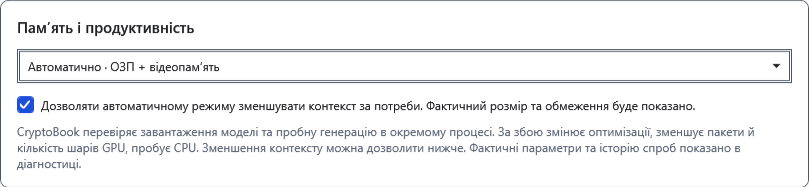
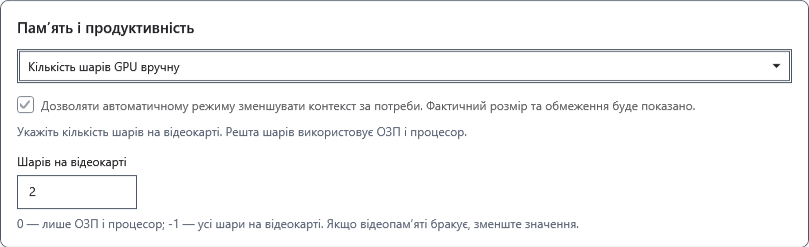
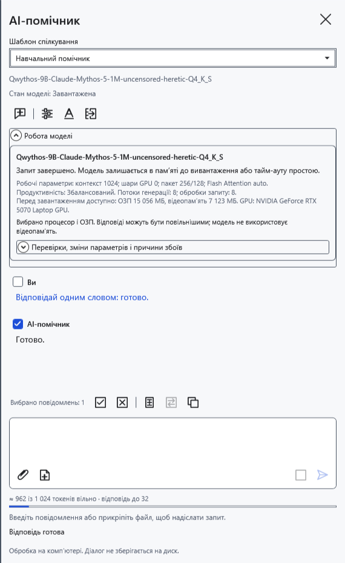
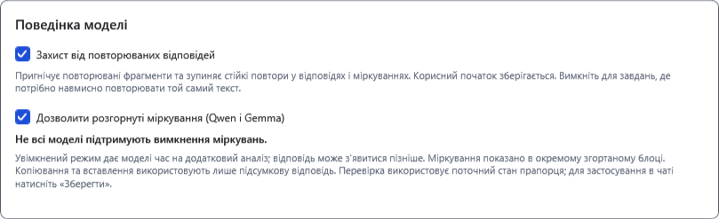
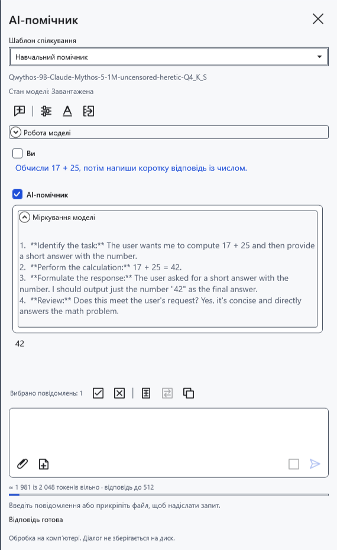

# Пам’ять, GPU та поведінка відповіді

Параметри зберігаються окремо для вибраного файла GGUF. Спершу скопіюйте потрібні відповіді: зміна контексту, режиму пам’яті чи поведінки відповіді може очистити чат і вимагати нового завантаження.

## Вибрати розміщення моделі

1. Відкрийте **Налаштування моделі → Додаткові параметри → Пам’ять і продуктивність**.
2. Почніть з **Автоматично · ОЗП + відеопам’ять**. Програма добирає розміщення за доступною пам’яттю; після невдалого завантаження може зменшити кількість шарів GPU або перейти на CPU. Це не гарантує, що будь-яка модель уміститься.
3. Якщо це прийнятно, дозвольте автоматичному режиму зменшувати контекст. Тоді фактичне вікно може бути меншим за задане. Без дозволу великий контекст не повинен мовчки зменшуватися. Перевіряйте розмір і попередження в **Робота моделі**.

4. Для ручного вибору скористайтеся **Кількість шарів GPU вручну** та полем **Шарів на відеокарті**. Значення 0 залишає шари на CPU; −1 запитує всі шари на GPU; додатне число запитує стільки шарів. «Усі» не означає достатньої пам’яті. Підтримка залежить від моделі, драйвера й обладнання.

5. Для роботи без перенесення шарів на GPU виберіть **Лише процесор · ОЗП**. Натисніть **Зберегти**, надішліть коротке запитання й розгорніть **Робота моделі**. Порівняйте фактичні шари GPU, контекст і потоки з очікуваннями. CPU може бути повільнішим; ОЗП усе одно потрібна.

Якщо пам’яті бракує, зменште контекст, виберіть менший GGUF або вивантажте непотрібну модель. Не збільшуйте шари GPU лише заради швидкості. Програма не закриває інші застосунки. Автозменшення контексту не діє під час заміру продуктивності: він перевіряє вибраний розмір.

## Міркування й захист від повторів

У тому самому розділі знайдіть параметри поведінки:

- **Дозволити розгорнуті міркування (Qwen і Gemma)** дозволяє підтримуваній моделі видавати аналіз. Прапорець не додає цієї здатності іншим моделям і не гарантує, що певний GGUF його дотримуватиметься. Міркування займають час і спільний контекст. Вимкнення не гарантує відсутності пояснень у звичайній відповіді.
- **Захист від повторюваних відповідей** поєднує обмеження повторів під час вибору токенів і зупинку стійкого точного зациклення. Уже отриманий корисний початок залишається. Перефразовані повтори можуть не розпізнаватися. Для навмисно однакових рядків тимчасово вимкніть захист, а потім увімкніть знову.

Якщо модель надає окремий аналіз, його можна розгорнути в повідомленні. Копіювання й перенесення використовують відповідь без окремо позначених міркувань. Не кожен GGUF надає такий канал; відсутність блоку аналізу сама по собі не помилка.

До збереження натисніть **Скасувати**. Після збереження поверніть попередні значення й збережіть знову; очищене листування це не відновлює. Якщо ручний режим не завантажується, поверніться до автоматичного чи CPU та перевірте коротким запитом.

- [Контекст і межа відповіді](help:ai.context)
- [Продуктивність і замір](help:ai.performance)
- [Вибір і перевірка моделі](help:ai.models)
- [Помилки помічника](help:ai.troubleshoot)
