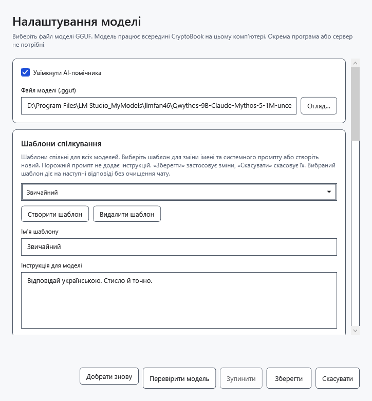
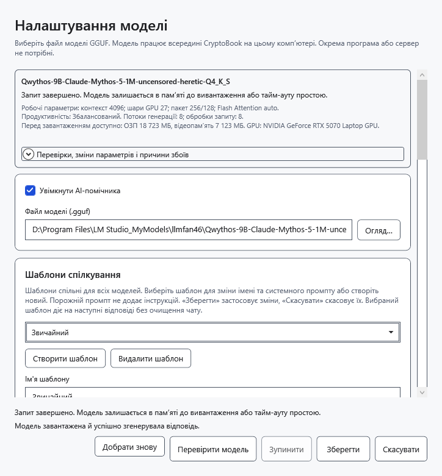
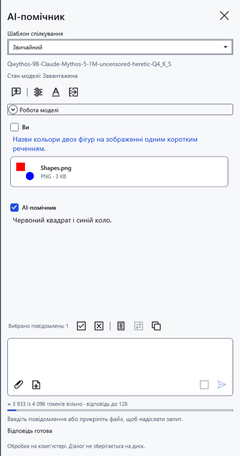

# Вибрати й перевірити модель

Мовна модель — локальний файл `.gguf`. Вибирайте саму модель, а не допоміжний `mmproj`. Підтримку архітектури й достатність пам’яті перевіряють запуском; саме розширення GGUF не гарантує сумісності.

## Налаштувати модель

Перед зміною моделі перенесіть потрібні відповіді в документ: зміна очищає чат, чернетку та вкладення й вивантажує попередні ваги.

1. Відкрийте **Налаштування → AI-помічник → Налаштування моделі** або шестерню в панелі.
2. Позначте **Увімкнути AI-помічника**. Натисніть **Огляд…** біля поля **Файл моделі (.gguf)** і виберіть наявний мовний GGUF. Можна також ввести повний шлях або вибрати раніше налаштовану модель зі списку, який з’являється за наявності кількох моделей.
3. За бажанням натисніть **Перевірити модель**. Перевірка використовує поточні значення вікна, справді завантажує модель і просить коротку відповідь. **Зупинити** скасовує перевірку. Успішна текстова перевірка ще не підтверджує роботу зображень.
4. Натисніть **Зберегти**, щоб застосувати параметри й закрити вікно. **Скасувати** або закриття вікна відкидає незбережені правки; виконана перевірка могла залишити модель завантаженою.

## Якщо потрібні зображення

Потрібні модель із підтримкою зору та сумісний із нею проєктор. Покладіть рівно один GGUF із `mmproj` у назві поруч із мовним GGUF. CryptoBook знаходить його автоматично; окремого поля вибору проєктора немає. За відсутності або наявності кількох таких файлів надсилання зображення не працюватиме. Назва сама по собі не підтверджує сумісності: невідповідний проєктор може спричинити помилку обробки.

Після збереження прикріпіть безпечне тестове зображення й запитайте про видимі деталі. Лише справжня відповідь на зображення перевіряє цю можливість. Кодувальник зображення використовує CPU й оперативну пам’ять; обробка може тривати довше за текстову відповідь.

## Збереження та помилки

Параметри запам’ятовуються для кожного файлу моделі; шаблони спілкування спільні для всіх моделей. **Добрати знову** повторює автоматичний добір пам’яті; це не завантаження нової версії GGUF і не добір максимальної швидкості. Після перевірки чи зміни параметрів за потреби натисніть **Вивантажити модель** в панелі. Якщо файл переміщено, виберіть новий шлях. Помилка збереження залишає вікно відкритим: усуньте причину або натисніть **Скасувати**.

- [Увімкнути помічника](help:ai.start)
- [Життєвий цикл моделі](help:ai.lifecycle)
- [Діагностика помилок](help:ai.troubleshoot)
- [Вкладення](help:ai.attachments)
- [Пам’ять моделі](help:ai.memory)
