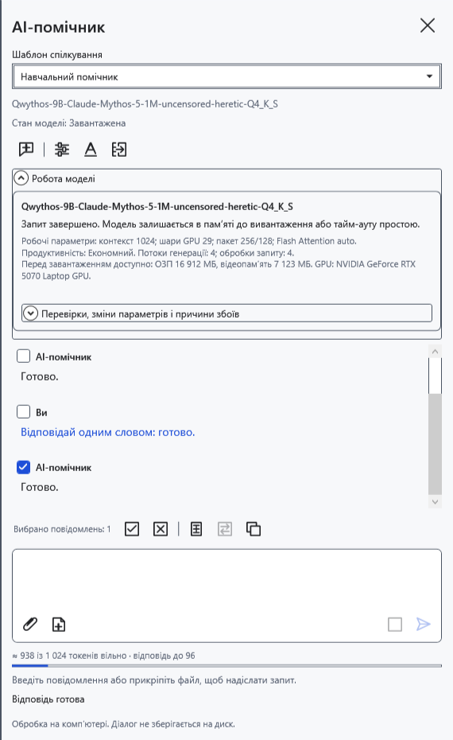
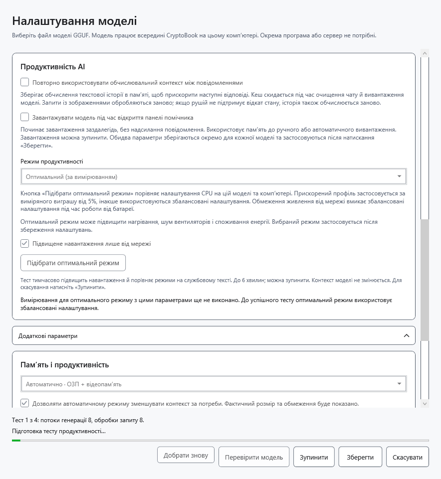
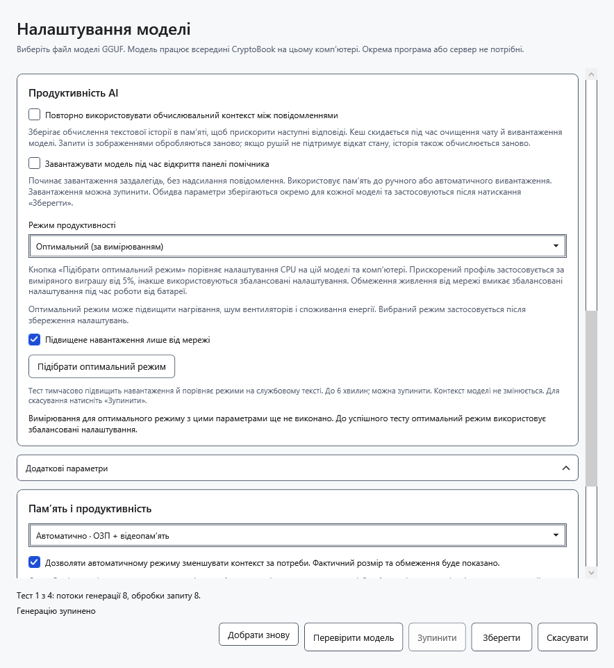
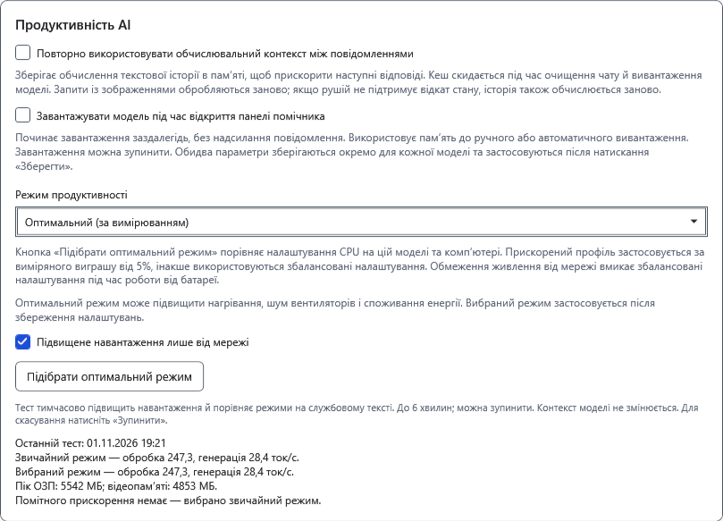

# Продуктивність AI та замір

Режим вибирається добровільно й зберігається окремо для файла моделі. Швидкість залежить від обладнання, моделі, контексту й поточного навантаження. Більше навантаження не гарантує швидшої відповіді.

## Вибрати режим

1. Відкрийте **Налаштування моделі → Продуктивність AI → Режим продуктивності**.
2. Виберіть **Збалансований** для звичайної роботи. **Економний** зменшує кількість потоків і застосовує енергоощадне планування Windows. Це не жорстке обмеження потужності GPU й не обіцянка певного часу роботи від батареї.
3. Натисніть **Зберегти** й надішліть коротке запитання. У **Робота моделі** видно чинний профіль. Зміна режиму зберігає чат і чернетку, але звільняє попередній worker; наступний запит знову завантажує модель.

## Дібрати оптимальний режим

Спершу завершіть поточну відповідь. Під час тесту можливі більше навантаження, нагрівання й шум; не запускайте кілька замірів одночасно.

4. У налаштуваннях виберіть **Оптимальний (за вимірюванням)**. Типово ввімкнено **Підвищене навантаження лише від мережі**. Від батареї це обмеження блокує підвищене навантаження; вимикайте його лише свідомо.
5. Натисніть **Підібрати оптимальний режим**. До **Зберегти** режим чату не змінюється. Замір прогріває модель і порівнює звичайний профіль із доступними варіантами підвищеного навантаження; це може тривати до шести хвилин. Перевіряється вибраний контекст без автозменшення.

6. За потреби натисніть **Зупинити**. Процес тесту звільняється; можна знову натиснути **Підібрати оптимальний режим**. Зупинка не є успішним вимірюванням.

7. Прочитайте результат: швидкості обробки входу й генерації, порівняння звичайного та вибраного профілів. Підвищене навантаження вибирається лише за виміряного виграшу щонайменше 5%; інакше залишається звичайний профіль. Числа стосуються цього тесту, а не гарантованої швидкості довгого чату чи зображень.

8. Натисніть **Зберегти**, щоб застосувати режим до чату. Живлення й доступна пам’ять перевіряються і під час подальшої роботи; обмеження можуть завадити підвищеному навантаженню.

## Повторити або повернутися

**Добрати знову** видаляє збережені автоматичний профіль і результат продуктивності цієї моделі та перевіряє її заново. Це не завантаження оновлених ваг. Після зміни моделі чи умов повторіть замір. **Підібрати оптимальний режим** також щоразу виконує новий замір.

**Скасувати** відкидає незбережені параметри вікна; завершений замір уже міг оновити кеш результату. Для повернення виберіть **Збалансований** і збережіть. Сам замір не видаляє чат. За нестачі ресурсів тест зупиняється або обмежує кандидатів, не закриваючи чужі програми. Зменште контекст, виберіть меншу модель або повторіть пізніше. Розміщення CPU/GPU може змінити результат.

- [Розміщення в пам’яті](help:ai.memory)
- [Контекст](help:ai.context)
- [Завантаження й зупинка](help:ai.lifecycle)
- [Помилки помічника](help:ai.troubleshoot)
