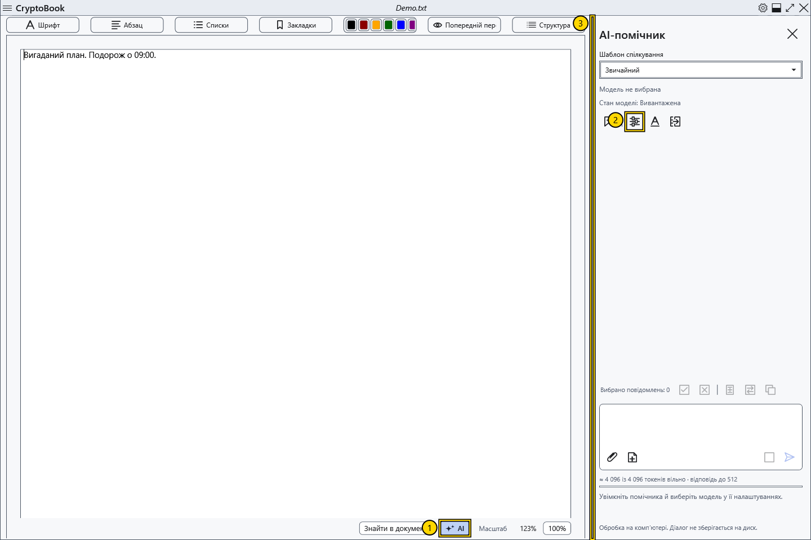

# Увімкнути локального AI-помічника

Помічник відповідає в правій панелі й обробляє запити локальною моделлю на вашому комп’ютері. Окремий сервер не потрібний. Файли моделі та vision-проєктора не входять до постачання CryptoBook: підготуйте їх окремо.

## Відкрити й увімкнути

1. Відкрийте звичайний документ і натисніть **AI** внизу редактора (1). В інших станах вікна скористайтеся **Налаштування → AI-помічник** і командою відкриття панелі.
2. У правій панелі натисніть шестерню **Налаштування моделі** (2). Вікно також доступне через **Налаштування → AI-помічник → Налаштування моделі**.
3. Позначте **Увімкнути AI-помічника**, виберіть мовний GGUF і натисніть **Зберегти**. Подробиці — у статті про модель.

4. Введіть вигадане пробне запитання й натисніть **Надіслати** або Ctrl+Enter у полі запиту. Дочекайтеся відповіді та перевірте її перед використанням.

## Результат і повернення

Панель показує назву вибраної моделі, **Стан моделі** та причину недоступності надсилання. Увімкнення помічника ще не означає завантаження моделі: зазвичай воно починається з першого запиту. Якщо **Надіслати** недоступна, прочитайте пояснення під полем вводу.

Перетягніть ліву межу панелі (3), щоб змінити ширину. Вона зберігається після закриття й повторного відкриття панелі та обмежується вільним місцем вікна. Повторне натискання **AI** приховує панель. Приховування не очищає чат і зазвичай залишає ваги завантаженими; для звільнення пам’яті натисніть **Вивантажити модель**. Незавершене попереднє завантаження під час приховування скасовується.

Щоб вимкнути помічника, зніміть **Увімкнути AI-помічника** в налаштуваннях. Це зупиняє модель і очищає поточний діалог. Чат, чернетка та вкладення зберігаються лише в пам’яті: вони не архівуються між запусками та видаляються під час очищення або скидання ключа. Параметри моделі й шаблони зберігаються окремо від листування. Локальна обробка не підтверджує достовірність відповіді й не додає моделі відсутніх можливостей.

- [Вибрати й перевірити модель](help:ai.models)
- [Завантаження, зупинка й вивантаження](help:ai.lifecycle)
- [Якщо помічник не відповідає](help:ai.troubleshoot)
- [Чат і повідомлення](help:ai.chat)
