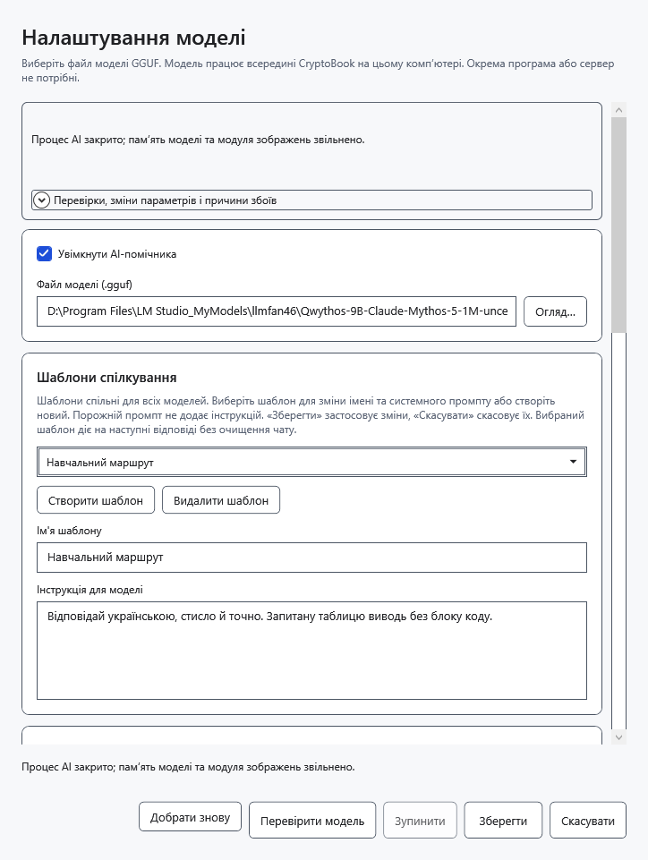
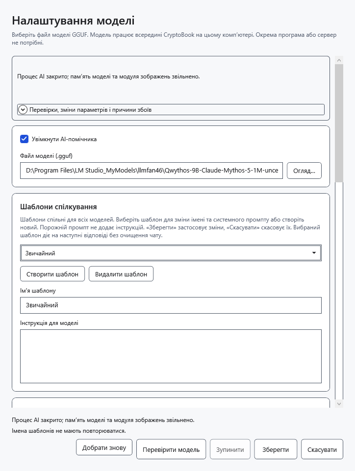
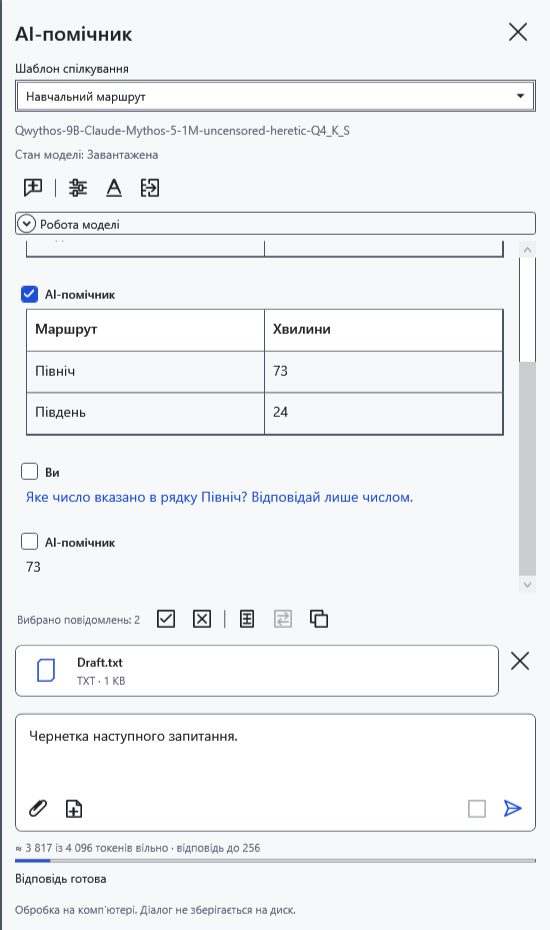
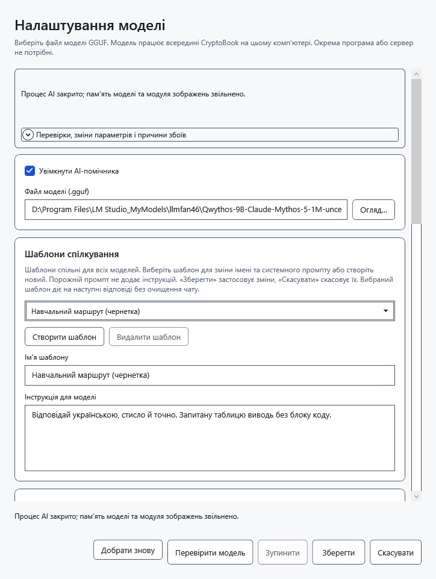

# Налаштувати спільні шаблони спілкування

Шаблон — спільна інструкція для наступних запитів будь-якої вибраної моделі. Це не окремий чат або профіль пам’яті. У постачанні шість варіантів: **Звичайний**, **Короткі відповіді**, **Докладні пояснення**, **Редактор тексту**, **Аналітик**, **Помічник програміста**.

## Створити або змінити

1. У AI-панелі відкрийте **Налаштування моделі** та прокрутіть до **Шаблони спілкування**.
2. Натисніть **Створити шаблон** або виберіть наявний варіант зі списку.
3. Введіть непорожнє унікальне **Ім'я шаблону**.
4. Заповніть **Інструкція для моделі**. Порожня інструкція допустима й не додає власних вказівок. Натисніть **Зберегти**, щоб застосувати.

За порожнього імені вікно попросить його вказати. Повторювані імена, зокрема відмінні лише регістром, не зберігаються. Виправте ім’я та повторіть **Зберегти**.

## Вибрати для наступного запиту

Угорі панелі виберіть **Шаблон спілкування**. Вибір зберігається й діє для всіх моделей. Отримані відповіді не переписуються; історія, чернетка, вкладення й завантажені ваги залишаються. Під час відповіді список у панелі недоступний. Зміни шаблону у вікні налаштувань діють із наступного запиту.

Інструкція задає бажану поведінку, але не гарантує її дотримання моделлю. Імена вбудованих варіантів перекладаються разом з інтерфейсом; власні імена й текст інструкцій автоматично не перекладаються. Оновлення зберігають правки, додавання й видалення замість заміни початковим набором. Старі інструкції окремих моделей можуть з’явитися як додаткові спільні шаблони.

## Видалити або скасувати

Виберіть варіант і натисніть **Видалити шаблон**, потім **Зберегти**. Це видаляє його зі спільного набору. Останній шаблон видалити не можна.

**Скасувати** або закриття вікна відкидає незбережені створення, редагування, видалення та вибір. Після збереження універсального скасування видалення немає. Зміна лише шаблонів зберігає чат; зміна самої моделі чи інших її параметрів у тому самому вікні може очистити діалог, тому спочатку перенесіть потрібні відповіді в документ.

- [Чат і вибір повідомлень](help:ai.chat)
- [Вибір моделі](help:ai.models)
- [Перенесення відповіді](help:ai.apply)
