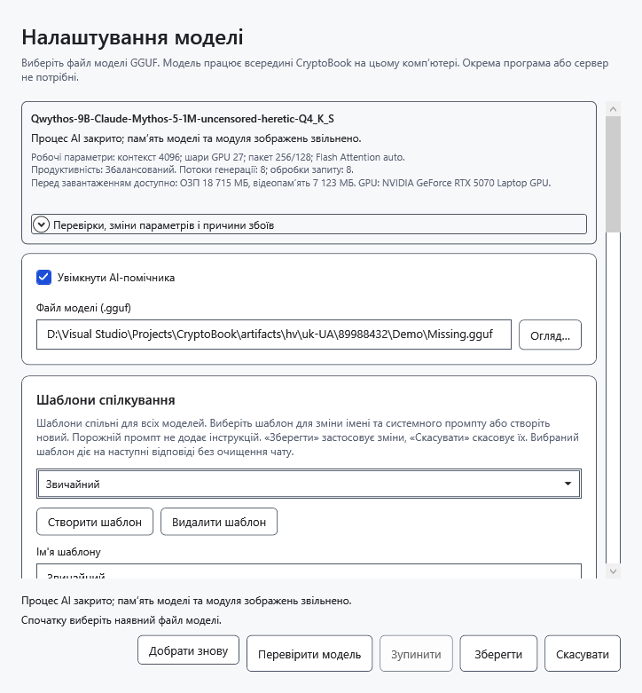

# Якщо AI-помічник не відповідає

Спочатку прочитайте пояснення під полем запиту, текст помилки та **Стан моделі**. Вони описують різні речі: завантажені ваги можуть залишатися в пам’яті після завершеної або зупиненої відповіді.

## Надсилання недоступне

- Помічника вимкнено: відкрийте **Налаштування моделі**, позначте **Увімкнути AI-помічника**, виберіть GGUF і збережіть.
- Порожнє запитання без вкладень: введіть запитання. Під час читання вкладень дочекайтеся завершення.
- Попередній запит виконується: дочекайтеся відповіді або натисніть **Зупинити**.
- Робочий простір справді заблоковано: спочатку розблокуйте його попереднім ключем. Сама наявність збереженого знімка не забороняє звичайні запити.

## Помилка моделі або зображення

**Спочатку виберіть наявний файл моделі.** означає, що шлях порожній або файл недоступний. Підключіть носій або виберіть наявний файл. Вибір `mmproj` замість мовної моделі чи неправильний заголовок файлу спричиняє відмову формату. Перейменування іншого файлу на `.gguf` не робить його моделлю. Помилка не зберігає хибні параметри замість попередніх.

Текст працює, а зображення ні: перевірте підтримку зору, сумісність проєктора й наявність рівно одного GGUF із `mmproj` у назві поруч із моделлю. Не вибирайте його замість моделі. Помилка кодувальника може означати несумісність, пошкодження картинки чи нестачу пам’яті; спробуйте невелике коректне зображення. Текстова перевірка не перевіряє vision.

## Нестача пам’яті, довгий чат або збій

1. Якщо операція активна, натисніть **Зупинити** й дочекайтеся завершення. Для звільнення ваг скористайтеся **Вивантажити модель**.
2. Розкрийте **Робота моделі → Перевірки, зміни параметрів і причини збоїв**. Тут видно виконані спроби та фактичні параметри; після автоматичного добору вони можуть відрізнятися від запитаних.
3. За нестачі пам’яті виберіть меншу модель або контекст. У додаткових параметрах можна вибрати автоматичну пам’ять чи роботу лише в RAM. Це може знизити швидкість. **Добрати знову** в автоматичному режимі повторює добір; успіх будь-якої моделі не гарантований.
4. Якщо діалог не вміщується в контекст, спершу перенесіть потрібну відповідь у документ, потім почніть **Новий чат** або зменште вкладення. Очищення незворотно видаляє листування з пам’яті. Збільшення контексту потребує більше пам’яті.

Відсутність видимого тексту не обов’язково означає вивантаження: збільште допустиму довжину відповіді та перевірте налаштування міркувань. Захист від повторів може зупинити тривалі буквальні повторення; він не виявляє будь-які смислові повтори.

У разі збою окремого процесу документ залишається відкритим. Збережіть потрібну часткову відповідь і повторіть запит вручну після усунення причини. До появи тексту автоматичний добір може повторити запуск із безпечнішими параметрами; після часткової відповіді автоматичного повторення немає. Несподіваний вихід у простої змінює стан на **Вивантажена**; новий запит знову завантажує модель. Зупинка, явне вивантаження та збій процесу — різні результати.

- [Вибір і перевірка моделі](help:ai.models)
- [Зупинка й вивантаження](help:ai.lifecycle)
- [Пам’ять](help:ai.memory)
- [Вкладення](help:ai.attachments)
- [Відновлення після скидання ключа](help:recovery.lock)
