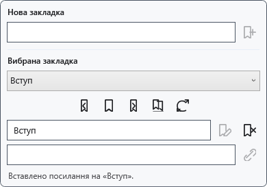
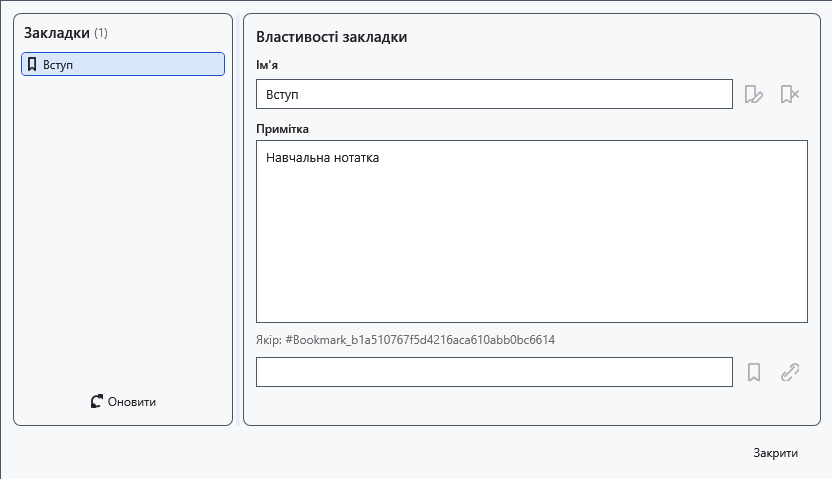

# Закладки, нотатки та внутрішні посилання

Закладка позначає місце звичайного документа. Зберігайте документ у XamlPackage або захищеному форматі CryptoBook: позиції закладок, назви, нотатки й внутрішні посилання відновлюються після відкриття. Закладки, втрачені під час збереження в попередніх версіях, автоматично не відновлюються.

## Порядок дій

1. Поставте каретку й розгорніть **Закладки** над документом. Введіть ім'я та натисніть **Додати в позиції каретки**.
2. Виберіть закладку. **Перейти до вибраної закладки**, **Попередня закладка** та **Наступна закладка** розташовують рядок закладки по центру видимої області редактора й ненадовго підсвічують його. Прокручування обмежене краями документа. Сусідні переходи обходять документ по колу; внутрішні посилання також центрують і підсвічують місце закладки.
3. Введіть нове ім'я й натисніть **Перейменувати вибрану закладку**. Для посилання поставте каретку в іншому місці, задайте текст і натисніть **Вставити посилання на вибрану закладку**.
4. Відкрийте **Відкрити диспетчер закладок**, виберіть запис та змініть нотатку. **Оновити індекс із документа** перечитує якорі поточного документа.

У посторінковому режимі перегляду ці команди й внутрішні посилання відкривають сторінку із закладкою, зберігаючи режим перегляду, і підсвічують потрібний рядок на 2,5 секунди. Підсвічування не змінює оформлення документа. Створення нової закладки та вставлення посилання доступні лише в редакторі, зокрема в окремому диспетчері; введені ім'я та текст посилання зберігаються під час перемикання режимів. Переходи за внутрішніми посиланнями й між сусідніми закладками оновлюють вибраний запис меню «Закладки» в обох режимах.

## Перевірка, скасування та обмеження

Перевірте ім'я й перехід. **Видалити вибрану закладку** прибирає якір і перетворює всі посилання на нього на звичайний текст зі збереженням підписів і користувацького оформлення; інші закладки та зовнішні посилання зберігаються. Виправте порожнє або зайняте ім'я за повідомленням панелі. Закриття диспетчера не скасовує внесених змін: збережіть документ явно. Оновіть індекс, якщо переміщення чи видалення тексту прибрало закладку. TXT, XAML і RTF не гарантують збереження якорів і нотаток.

## Пов’язані теми

- [Вебпосилання та підписи](help:edit.links)
- [Дерево структури документа](help:content.structure)
