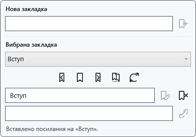
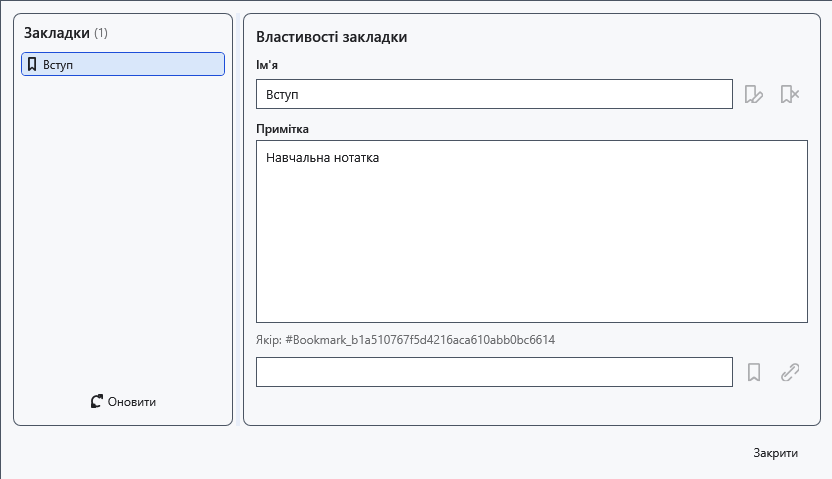

# Закладки, нотатки та внутрішні посилання

Закладка позначає місце звичайного документа. У поточному збереженні XamlPackage якорі й нотатки не відновлюються після відкриття. Текст посилання може залишитися, але перехід до закладки перестане працювати. Не використовуйте закладки як єдину навігацію збереженого файла.

## Порядок дій

1. Поставте каретку й розгорніть **Закладки** над документом. Введіть ім'я та натисніть **Додати в позиції каретки**.
2. Виберіть закладку. **Перейти до вибраної закладки**, **Попередня закладка** та **Наступна закладка** переміщують каретку; сусідні переходи обходять документ по колу.
3. Введіть нове ім'я й натисніть **Перейменувати вибрану закладку**. Для посилання поставте каретку в іншому місці, задайте текст і натисніть **Вставити посилання на вибрану закладку**.
4. Відкрийте **Відкрити диспетчер закладок**, виберіть запис та змініть нотатку. **Оновити індекс із документа** перечитує якорі поточного документа.

## Перевірка, скасування та обмеження

Перевірте ім'я й перехід. **Видалити вибрану закладку** прибирає якір, а не файл документа. Виправте порожнє або зайняте ім'я за повідомленням панелі. Закриття диспетчера не скасовує внесених змін: збережіть документ явно. Оновіть індекс, якщо переміщення чи видалення тексту прибрало закладку. TXT, XAML і RTF не гарантують збереження якорів і нотаток.

## Пов’язані теми

- [Вебпосилання та підписи](help:edit.links)
- [Дерево структури документа](help:content.structure)
