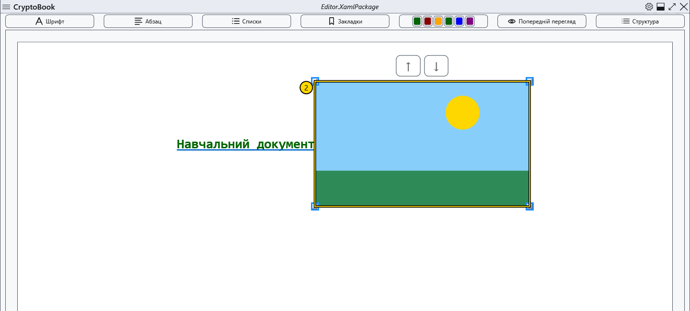
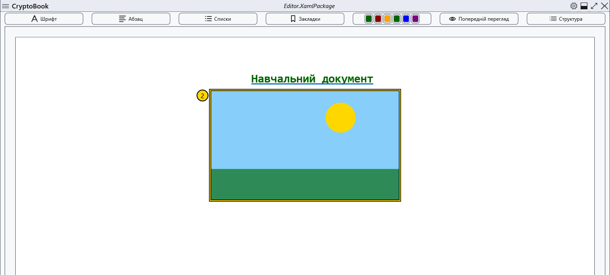
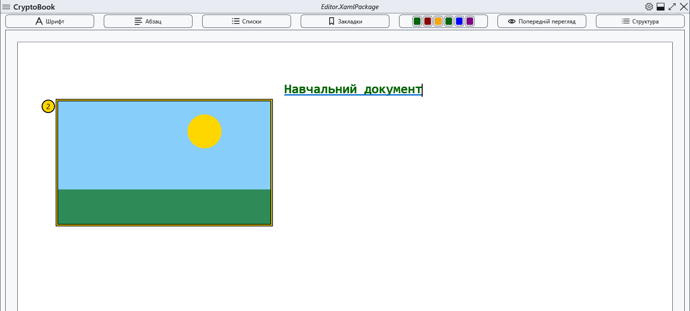
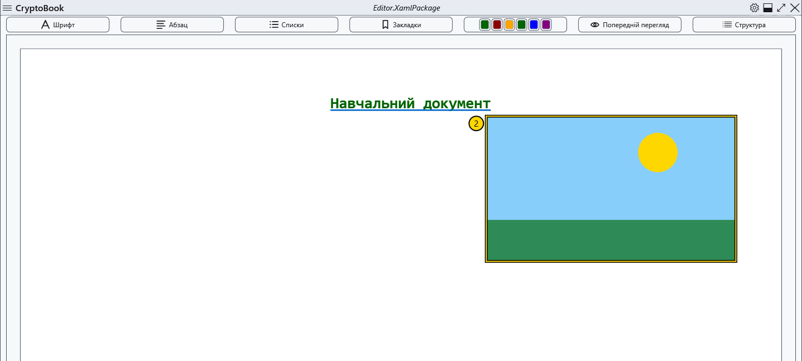

# Вбудовані зображення

Зображення вставляється у звичайний документ. Почніть із витратної копії в редагуванні; для повного збереження розміщення використовуйте XamlPackage.

## Порядок дій

1. Поставте каретку та відкрийте **Зміст** → команду вставлення зображення або відповідний пункт контекстного меню. Виберіть файл; скасування вибору не змінює документ.
2. Клацніть зображення: з'являться маркери зміни розміру. Перетягуйте маркер, перевіряючи пропорції та межі аркуша.
3. У контекстному меню зображення виберіть розміщення: у рядку, окремим блоком по центру, з обтіканням ліворуч або праворуч. Чотири знімки нижче показують результати в цьому порядку.

## Перевірка, скасування та обмеження

Перетягування змінює позицію; команди вище/нижче та Alt+↑/↓ переміщують вибране зображення за наявності допустимого місця. Delete видаляє вставку, Esc знімає вибір; вихідний файл залишається на диску. Скасування видалення не гарантує відновлення самого зображення. Збережіть копію заздалегідь; якщо Ctrl+Z не повернув зображення, вставте оригінал знову. Повторно відкрийте збережену копію та перевірте розміри й розташування. У Markdown використовуйте відносне посилання на локальне зображення.

## Пов’язані теми

- [Тло та кадрування сторінки](help:content.background)
- [Формати й кодування](help:doc.formats)
