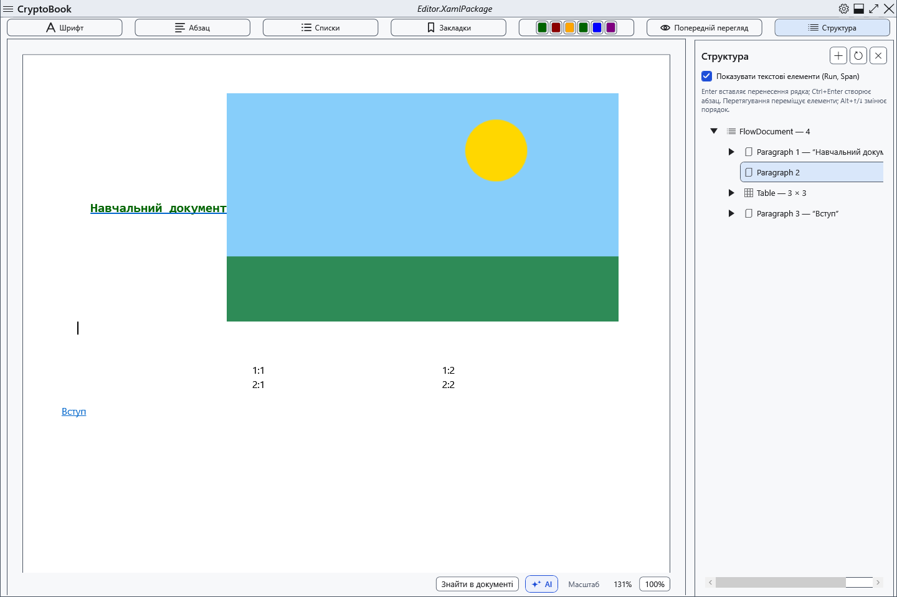

# Дерево структури документа

Панель структури допомагає знаходити й переставляти частини звичайного документа. Зробіть копію перед видаленням великих фрагментів.

## Порядок дій

1. Натисніть **Структура** над документом. Розгорніть вузли та ввімкніть текстові елементи для подробиць. За потреби оновіть дерево після змін.
2. Виберіть вузол для переходу. Через контекстне меню додайте абзац до, всередині або після допустимого елемента; кнопка додавання та Ctrl+Enter використовують поточний вибір.
3. Команди вгору/вниз, Alt+↑/↓ та перетягування змінюють порядок, якщо нове місце допускає елемент. Видалення вузла прибирає його вміст із документа.

## Перевірка, скасування та обмеження

Перевірте текст і сусідні вузли. Ctrl+Z скасовує підтримувані зміни редактора; закриття панелі нічого не скасовує. Не всі елементи можна видалити чи довільно вкласти один в одного: корінь і захищені якорі мають обмеження. У перегляді навігація та зміни через дерево вимкнені; поверніться до редагування. Після складної перестановки збережіть копію XamlPackage та відкрийте її знову.

## Пов’язані теми

- [Основні операції з текстом](help:edit.basic)
- [Редагування наявної таблиці](help:content.tables)
