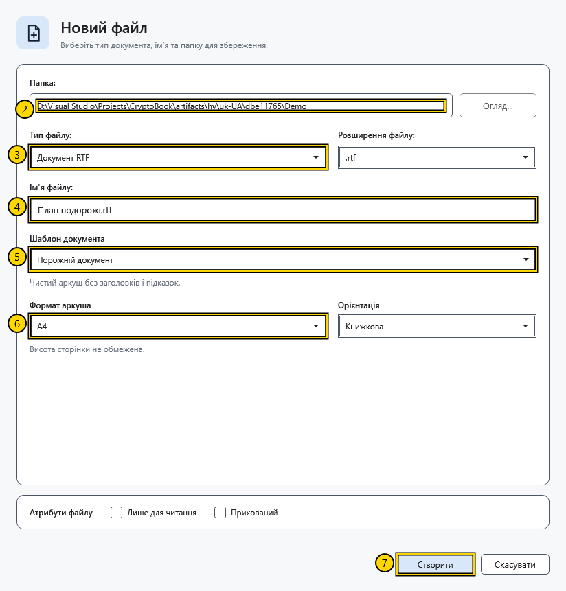
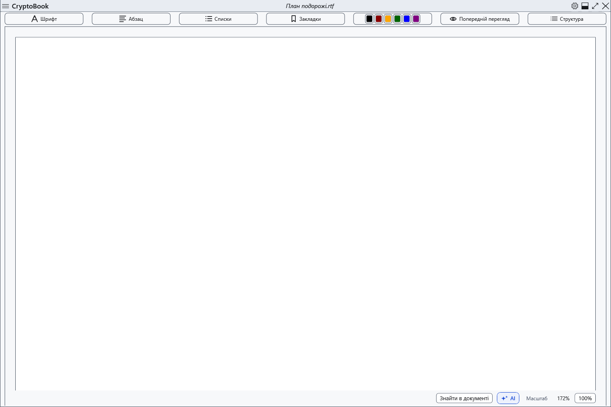
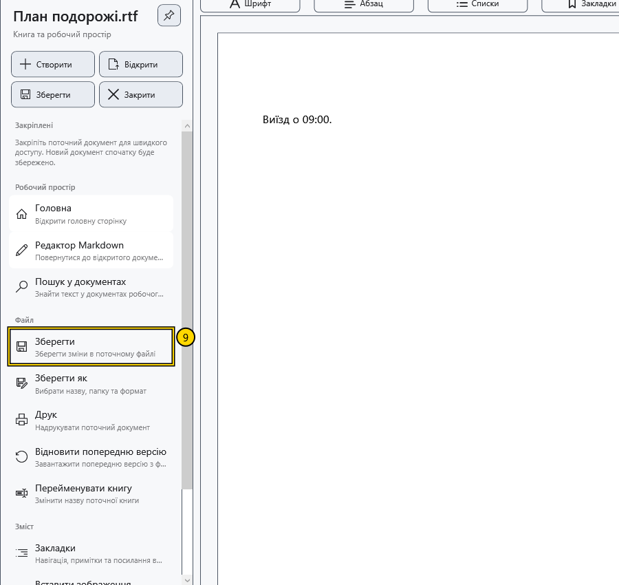
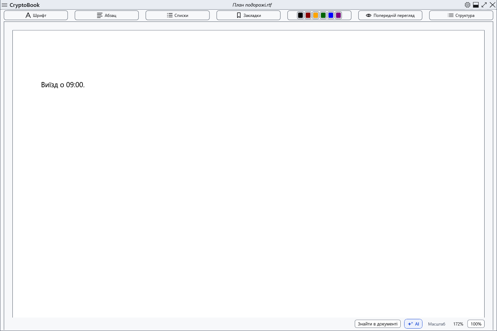
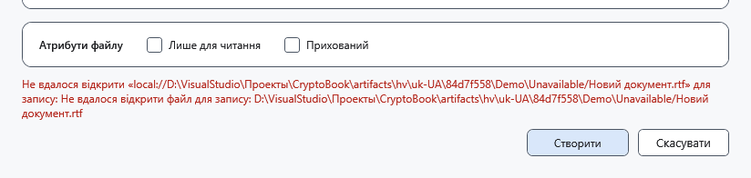

# Створити та зберегти документ

Створіть порожній RTF-файл, додайте короткий рядок і збережіть зміни. RTF підходить для звичайного документа з оформленням тексту.

## Перед початком

Використовуйте локальну папку, у якій можна створювати файли, та незайняте ім’я. У прикладі створюється **План подорожі.rtf**. Перед початком збережіть зміни у вже відкритому документі. RTF-файл не захищений паролем.

## Порядок дій

1. На початковому екрані натисніть **Новий документ**. Якщо документ уже відкрито, скористайтеся швидкою дією **Створити** в бічному меню.
2. У полі **Папка:** натисніть **Огляд...** і виберіть демонстраційну папку.
3. У полі **Тип файлу:** виберіть **Документ RTF** і перевірте **.rtf** у полі **Розширення файлу:**.
4. У полі **Ім'я файлу:** введіть **План подорожі.rtf**. Вводьте ім’я після вибору типу: зміна типу замінює запропоноване ім’я.
5. У полі **Шаблон документа** виберіть **Порожній документ**.
6. Установіть **Формат аркуша** — **A4**, **Орієнтація** — **Книжкова**. Для цього прикладу залиште прапорці **Лише для читання** та **Прихований** знятими.

7. Натисніть **Створити**. Дочекайтеся відкриття нового файлу у звичайному редакторі та перевірте його ім’я у верхньому рядку.

8. Клацніть сторінку та введіть **Виїзд о 09:00.**
9. Відкрийте бічне меню й у розділі **Файл** натисніть **Зберегти**. Можна також натиснути **Ctrl+S**, коли фокус перебуває в редакторі.

## Перевірка результату

Ще раз відкрийте той самий RTF-файл швидкою дією **Відкрити** в бічному меню. Рядок **Виїзд о 09:00.** має залишитися на сторінці. Перевірте фактичне ім’я документа, якщо через збіг програма підібрала інше вільне ім’я.

## Скасування та повернення

До натискання **Створити** можна вийти з діалогу кнопкою **Скасувати**. Після створення закриття документа не видаляє файл. Для іншого імені чи папки використовуйте **Файл → Зберегти як**; у разі зміни типу файлу склад збереженого оформлення може змінитися.

## Якщо не вдалося

Якщо **Створити** недоступно, перевірте вибір папки, типу й імені, а також можливість запису в папку. У разі помилки прочитайте повідомлення та виправте ім’я або виберіть іншу папку. Якщо з’явилося **Файл створено, але його не вдалося відкрити.**, спочатку перевірте папку: файл уже міг з’явитися. **Зберегти** може бути недоступно, коли нових змін немає або звичайний документ відкрито в режимі читання.

## Інший тип, шаблон і атрибути

У цьому прикладі вибрано порожній RTF. Для підготовленого тексту виберіть інший **Шаблон документа**. Для Markdown виберіть відповідний тип файлу: відкриється окремий редактор, параметри аркуша буде приховано. Текстові типи, зокрема XAML, не зберігають оформлення.

**Лише для читання** та **Прихований** задають атрибути нового локального файлу. Вони не шифрують його й не захищають паролем. Для звичайної роботи залиште їх вимкненими. Можливості інших джерел можуть відрізнятися.

Якщо назва зайнята, програма добирає вільну назву; вона може відрізнятися від введеної. Указуйте лише назву файлу, папку вибирайте окремо. Після створення обов’язково перевірте назву у верхньому рядку та сам файл у папці.

Якщо вибрана папка стала недоступна, діалог може залишитися відкритим із помилкою. Виберіть доступну папку й повторіть створення. Перед повтором перевірте, чи не з’явився файл від попередньої спроби. Кнопка **Скасувати** не видаляє файл, який уже встиг записатися.

Для перевірки збереження спочатку закрийте збережений демонстраційний файл, потім відкрийте його знову: повторний вибір уже активного файлу може лише повернути його редактор.

## Пов’язані теми

- [Основні області вікна](help:start.interface)
- [Зберегти та «Зберегти як»](help:doc.save)
- [Вибрати шаблон документа](help:doc.templates)
- [Формати й кодування](help:doc.formats)
