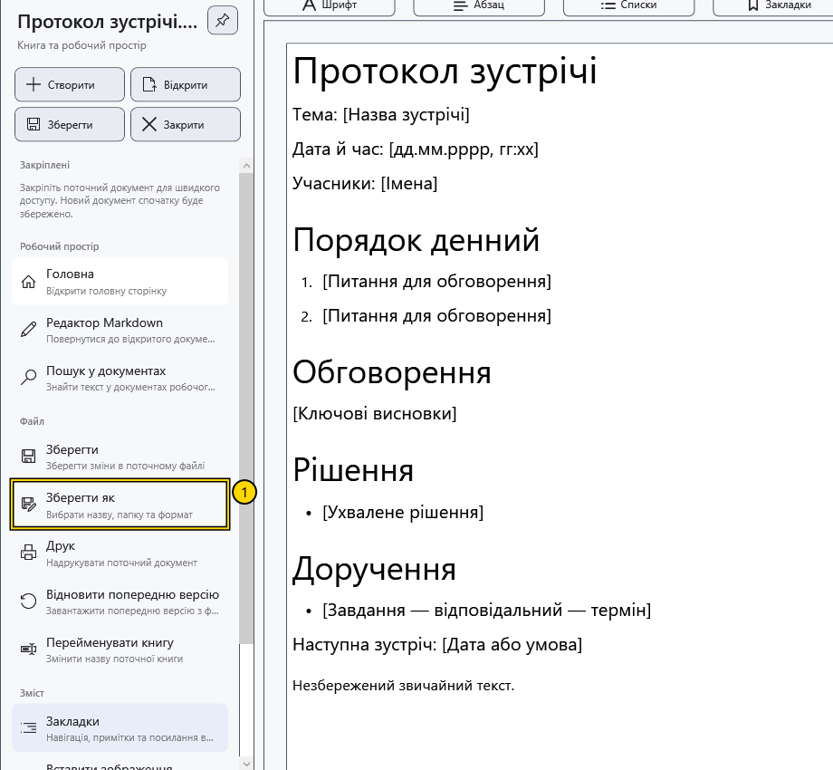

# Формати й кодування

Формат визначає, що залишиться після збереження та повторного відкриття. Для тексту без оформлення підходить TXT; для оформленого документа вибирайте RTF або XamlPackage. Перевіряйте результат на копії перед перетворенням важливого файлу.

## Що зберігається

| Формат | Поведінка в CryptoBook |
| --- | --- |
| RTF (`.rtf`) | Оформлений текст; підтримуються вбудовані зображення. Сумісність складної верстки з іншими редакторами перевіряйте окремо |
| XamlPackage (`.XamlPackage`) | Оформлений документ із вбудованими ресурсами; підходить для вмісту CryptoBook, зокрема тла сторінки |
| TXT та інші звичайні текстові типи | Текст без шрифтів, кольорів, зображень і структури таблиць |
| XAML (`.xaml`) | У поточній програмі відкривається та зберігається як звичайний текст; це не заміна XamlPackage |
| Markdown (`.md`, `.markdown`) | Вихідний текст розмітки в окремому редакторі; перегляд будується з нього |
| Захищений документ (`.cbook`) | Контейнер CryptoBook, для читання й запису якого потрібен відповідний ключ |

Під час текстового експорту слова з таблиці можуть залишитися, але сама таблиця та зображення не зберігаються. Зміна розширення у файловому менеджері не перетворює дані. Не розраховуйте на обов’язкове попередження про втрату оформлення.

## Як вибрати формат

1. Відкрийте **Файл → Зберегти як**.
2. Виберіть тип і відповідне розширення. Для Markdown пропонуються його вихідний формат і текстовий файл; звичайний документ не можна зворотним перетворенням зберегти в Markdown.
3. Збережіть під новою назвою. Закрийте копію, відкрийте знову та порівняйте текст, оформлення й зображення з оригіналом.

## Кодування

Окремого вибору довільного кодування в інтерфейсі немає. Звичайний текстовий експорт записує UTF-8 без BOM. RTF і XamlPackage використовують власне подання; це не простий текст UTF-8.

Новий Markdown створюється в UTF-8 без BOM. Для відкритого Markdown зберігаються розпізнані UTF-8, UTF-16 або UTF-32 з їхнім BOM і наявні закінчення рядків. Без BOM очікується UTF-8; старі однобайтові кодування автоматично не добираються. Якщо байти не відповідають розпізнаному кодуванню, можлива поява замінених символів і перехід до UTF-8 під час наступного збереження. Не перезаписуйте оригінал із нечитабельним текстом: скасуйте роботу з ним і підготуйте правильно перекодовану копію в зовнішньому редакторі.

## Перевірка результату та повернення

Після повторного відкриття перевірте кирилицю, українські літери, умлаути, закінчення рядків і суттєве оформлення. Скасування діалогу не змінює поточний формат. Після успішного **Зберегти як** для повернення до оригіналу відкрийте старий файл: наступні збереження вже спрямовано до копії.

PDF і медіа не є форматами збереження звичайного документа в цьому діалозі. Їхній перегляд описано окремо. Захист файлу не виправляє втрати, уже внесені текстовим експортом.

## Пов’язані теми

- [Зберегти та «Зберегти як»](help:doc.save)
- [Шаблони документів](help:doc.templates)
- [Збереження Markdown](help:md.save)
- [Перегляд PDF](help:view.pdf)
- [Сумісність захищених файлів](help:security.compatibility)
