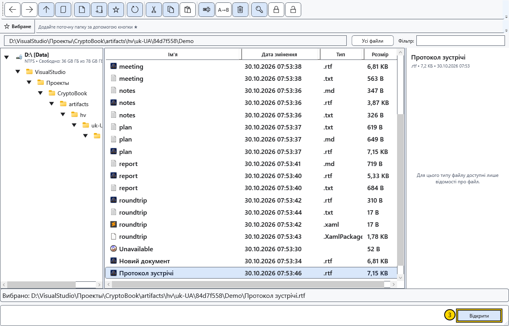

# Відкрити документ

Відкрийте наявний файл, щоб читати чи редагувати його. Звичайний документ і Markdown займають два незалежні редактори; відкриття іншого файлу того самого виду замінює документ у відповідному редакторі.

## Перед початком

Збережіть потрібні зміни. Якщо під час заміни документа з’явиться запит про збереження, скасування залишить поточний документ відкритим. Для захищеного файлу потрібен відповідний ключ; інші формати спрямовуються до відповідних засобів перегляду.

## Порядок дій

1. Натисніть **Відкрити файл** на початковому екрані або **Відкрити** у швидких діях бічного меню.
2. У файловому менеджері перейдіть до папки файлу. Шлях в адресному рядку стосується цього вікна й може відрізнятися від робочої директорії.

3. Виділіть один файл і скористайтеся **Відкрити** або двічі клацніть його. Для папки та сама дія показує її вміст.
4. Якщо з’явився запит про незбережені зміни, виберіть збереження, продовження без збереження або скасування. У разі помилки збереження не закривайте вихідний документ: спочатку усуньте причину або збережіть копію.

## Де відкриється файл

| Вміст | Результат |
| --- | --- |
| RTF, XamlPackage і звичайні текстові файли | Звичайний редактор на сторінці **Головна** |
| Markdown | **Редактор Markdown** із вихідним текстом і переглядом |
| Підтримувані зображення та відео | Відповідний перегляд або медіаплеєр |
| PDF | Зовнішня програма, призначена у Windows |
| Захищений файл CryptoBook | Відкриття після перевірки формату з відповідним ключем |

Саме розширення не перетворює вміст на інший формат. Не перейменовуйте довільний файл на `.rtf` чи `.cbook` для перетворення. Подвійне клацання у Провіднику Windows залежить від установлених файлових асоціацій.

## Перевірка результату та повернення

Звірте назву у верхньому рядку та кілька рядків вмісту. Повертайтеся до іншого редактора через **Робочий простір → Головна / Редактор Markdown**. Закриття файлового менеджера не закриває документ, уже відкритий у головному вікні.

У вікні вибору папки чи файлу кнопка підтверджує вибір для дії, яка його викликала; це відрізняється від звичайного файлового менеджера. **Скасувати** припиняє вибір. Якщо файл не відкривається, перевірте під’єднання диска, доступ на читання, справжній формат і потребу в ключі. Повідомлення про помилку не підтверджує успішне відкриття.

## Пов’язані теми

- [Формати й кодування](help:doc.formats)
- [Два редактори, перейменування та закриття](help:doc.switch)
- [Зберегти та «Зберегти як»](help:doc.save)
- [Сумісність захищених файлів](help:security.compatibility)
