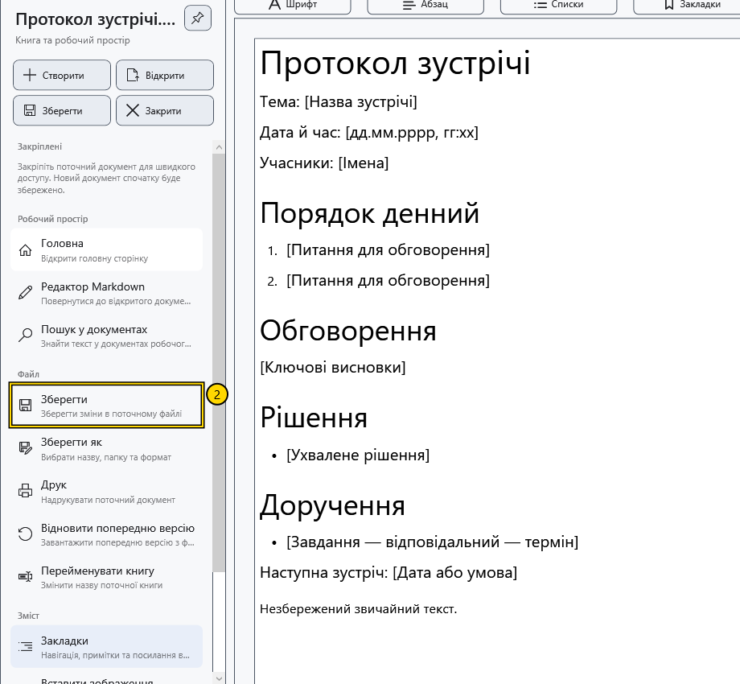
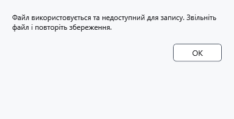

# Зберегти та «Зберегти як»

**Зберегти** записує зміни активного документа за його поточним шляхом. **Зберегти як** вибирає іншу назву, папку чи формат і після успішного запису робить новий шлях поточним.

## Перед початком

Перевірте назву у верхньому рядку та активний редактор. Звичайний документ і Markdown зберігаються незалежно.

> Перед заміною наявного файлу чи переходом до текстового формату збережіть потрібний оригінал окремо. Текстовий експорт втрачає оформлення; окремий запит про таку втрату з’являється не в усіх випадках.

## Зберегти поточний файл

1. Змініть документ.
2. Відкрийте бічне меню та натисніть **Зберегти** у швидких діях або **Файл → Зберегти**. У редакторі можна скористатися **Ctrl+S**.
3. Дочекайтеся завершення запису. Для документа без шляху потрібно буде вибрати призначення.

Якщо нових змін немає, команда може бути недоступна. Для звичайного документа в режимі читання спочатку поверніться до редагування.

## Зберегти в інше місце чи формат

1. Виберіть **Файл → Зберегти як** або **Ctrl+Shift+S** у редакторі.

2. У системному діалозі виберіть папку, назву та тип файлу. Перевірте розширення: воно також впливає на вибраний формат. Підтвердження перезапису замінює наявний файл. Написи системного діалогу залежать від мови Windows.
3. Підтвердьте запис і перевірте нову назву у верхньому рядку. Подальше **Зберегти** стосується нового шляху; старий файл не отримує наступних змін.

Звичайний оформлений документ не можна експортувати безпосередньо в Markdown. У Markdown доступні збереження вихідного тексту та його текстова копія; видимий перегляд не замінює вихідний текст під час збереження.

## Незбережені зміни

Під час закриття зміненого документа чи заміни його іншим файлом запит пропонує три рішення. Ствердна відповідь зберігає зміни й продовжує дію. Заперечна продовжує без запису останніх правок. Скасування зберігає документ відкритим і припиняє дію. Написи цих системних кнопок залежать від Windows.

Якщо збереження скасовано чи воно не вдалося, закриття або заміна не повинні завершуватися. Під час виходу з програми перевіряються обидва редактори. Перехід між уже відкритими звичайним документом і Markdown не вимагає відкидати їхні зміни.

## Перевірка результату

Закрийте збережений демонстраційний файл і відкрийте його знову. Перевірте останні рядки та потрібне оформлення. Наявність файлу з правильним розширенням не доводить, що останнє збереження завершилося.

## Скасування та помилки

**Скасувати** у виборі призначення залишає шлях і незбережений текст попередніми. Не закривайте редактор після помилки запису. Звільніть файл в іншій програмі, перевірте місце на диску й доступ до папки, потім повторіть **Зберегти** або виберіть інше призначення через **Зберегти як**.

Для захищеного збереження потрібні ключ і окреме підтвердження. Наявність ключа також може викликати пропозицію створити захищену копію звичайного файлу: читайте вибрану дію та підсумковий шлях. Не вважайте кожний збережений RTF чи TXT зашифрованим.

## Пов’язані теми

- [Формати й кодування](help:doc.formats)
- [Два редактори, перейменування та закриття](help:doc.switch)
- [Помилки запису та відновлення](help:recovery.write)
- [Шифрування документів](help:security.protect)
