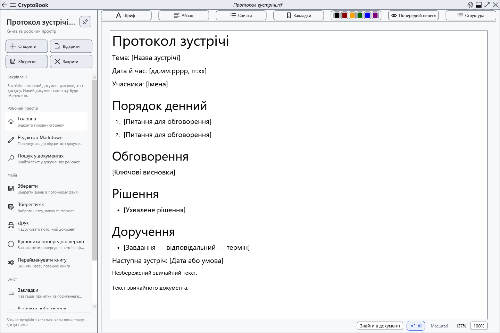
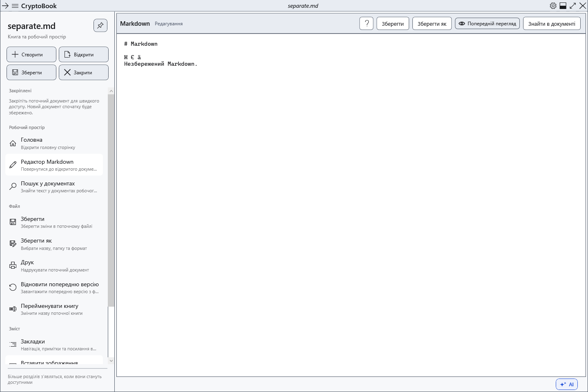
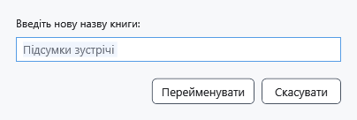

# Два редактори, перейменування та закриття

CryptoBook тримає звичайний документ і Markdown незалежно. Наприклад, можна залишити нотатки RTF на сторінці **Головна**, відкрити план Markdown і повернутися до нотаток разом із незбереженими змінами. Це два редактори, а не необмежений набір вкладок.

## Перемкнутися між документами

1. Відкрийте звичайний документ, потім Markdown через **Відкрити**.
2. Відкрийте бічне меню **Робочий простір** і виберіть **Головна** або **Редактор Markdown**. Команда Markdown доступна, коли такий документ уже відкрито.

3. Звірте назву у верхньому рядку перед **Зберегти**. Збереження одного редактора не зберігає другий.

Стрілки назад і вперед у верхньому рядку перемикають уже відкриті сторінки програми. Вони не скасовують правки та не повертають попередній файл після заміни документа іншим файлом того самого виду. Під час такої заміни незбережені зміни перевіряються окремо.

## Перейменувати книгу

1. Виберіть потрібний редактор і відкрийте **Файл → Перейменувати книгу**.
2. Введіть нову назву та підтвердьте **Перейменувати**. Розширення зберігається; змінювати формат цією командою не можна.

Для файлу на диску змінюється його назва в тій самій папці. Для документа без шляху змінюється назва поточної сесії; файл з’явиться лише після збереження. Перейменування не замінює збереження останніх правок. **Скасувати** залишає назву попередньою. Якщо назва зайнята чи недопустима або файл заблоковано, усуньте причину та перевірте фактичну назву після повідомлення про помилку.

## Закрити документ або програму

Швидка дія **Закрити** стосується активного документа. За незбережених змін виберіть збереження, продовження без запису або скасування. Скасування залишає документ відкритим; відмова від збереження втрачає останні правки цього документа. Успішне закриття одного редактора не закриває незалежний другий документ.

Хрестик головного вікна завершує програму та перевіряє зміни обох редакторів. Помилка чи скасування збереження перериває закриття. Закриття документа не видаляє його файл із диска. Щоб повернутися, відкрийте збережений файл знову; незбережені та відкинуті зміни цим не відновлюються.

## Перевірка результату

Внесіть різні рядки до витратних RTF і Markdown, перемкніться в обидва боки та переконайтеся, що тексти не змішалися. Збережіть кожний окремо й повторно відкрийте їх. Якщо показано неочікуваний файл, спочатку перевірте активну сторінку й назву, потім виконуйте збереження чи перейменування.

## Пов’язані теми

- [Відкрити документ](help:doc.open)
- [Зберегти та «Зберегти як»](help:doc.save)
- [Закріплені документи](help:files.pinned)
- [Нещодавні документи](help:files.recent)
