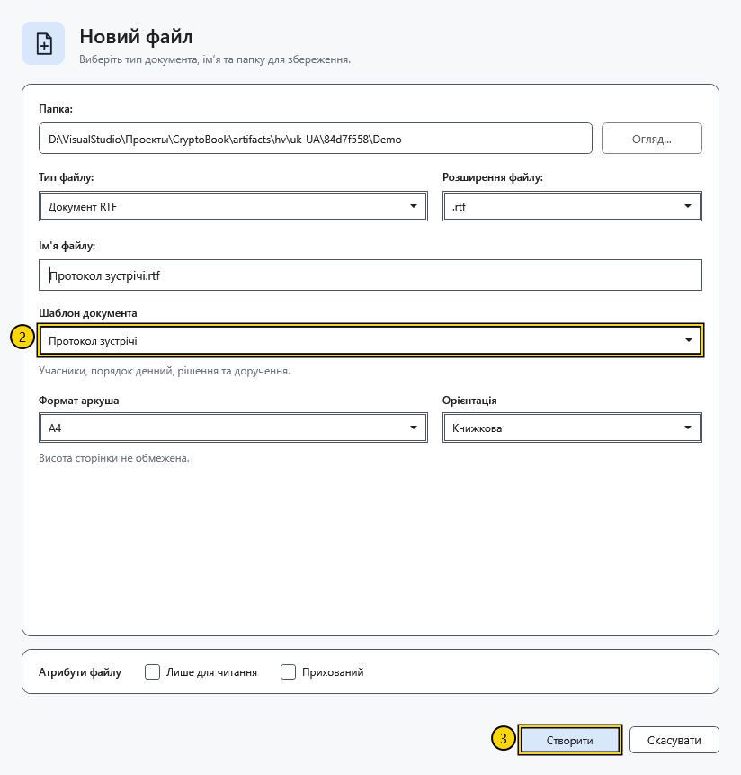

# Вибрати шаблон документа

Шаблон заповнює новий файл початковим вмістом. Наприклад, **Протокол зустрічі** дає заготовку для порядку денного та рішень. Тип файлу визначає спосіб зберігання, а шаблон — початковий текст.

## Порядок дій

1. Натисніть **Новий документ** на початковому екрані або **Створити** в бічному меню. Виберіть папку, тип файлу та назву.
2. У полі **Шаблон документа** виберіть заготовку. Прочитайте її опис під списком.

3. За потреби задайте формат аркуша й орієнтацію, потім натисніть **Створити**. Для Markdown параметри аркуша приховано.

| Шаблон | Коли використовувати |
| --- | --- |
| Порожній документ | Почати без підготовленого тексту |
| Нотатки | Зібрати короткі записи |
| План проєкту | Розкласти роботу на етапи |
| Протокол зустрічі | Записати обговорення, рішення та завдання |
| Щоденник | Зробити особистий запис |
| Звіт | Підготувати структурований підсумок |

У RTF і XamlPackage шаблон перетворюється на оформлений документ. У текстовому файлі оформлення втрачається. У Markdown залишається вихідний текст із розміткою. Мова нового вмісту відповідає мові програми на момент створення; зміна мови не перекладає вже записані файли.

## Типовий шаблон

Відкрийте **Налаштування → Зовнішній вигляд → Шаблон нового документа за замовчуванням**. Вибір застосовується до наступного діалогу створення; він не перезаписує наявні документи чи вже відкритий діалог. У кожному новому діалозі можна вибрати інший шаблон.

## Перевірка результату та скасування

Після створення перевірте заголовки й текст у відкритому файлі. Для перевірки збереження закрийте файл і відкрийте його знову. До створення натисніть **Скасувати**; файл не з’явиться. Скасування діалогу після створення не видаляє вже записаний файл.

Якщо очікувалося оформлення, перевірте тип файлу: **Текстовий файл** і **XAML-файл** зберігають лише текст. Зміна типового шаблону не замінює текст поточного документа.

## Пов’язані теми

- [Створити та зберегти документ](help:doc.create)
- [Формати й кодування](help:doc.formats)
- [Налаштування оформлення](help:settings.appearance)
