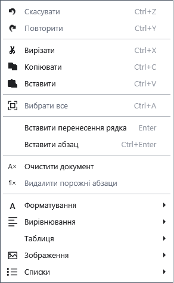

# Основні операції з текстом

Виділіть фрагмент, щоб замінити, скопіювати або видалити його. Команди працюють у звичайному редакторі; спочатку клацніть текст документа.

## Порядок дій

1. Виділіть текст мишею або Shift зі стрілками. Ctrl+A виділяє весь документ.
2. Відкрийте контекстне меню: **Копіювати** (Ctrl+C), **Вирізати** (Ctrl+X), **Вставити** (Ctrl+V). Вставлення замінює виділений фрагмент.
3. Скористайтеся **_Скасувати** (Ctrl+Z) і **_Повторити** (Ctrl+Y). Enter переносить рядок усередині поточного абзацу; Ctrl+Enter створює новий абзац.

## Перевірка, скасування та обмеження

**_Очистити документ** видаляє весь вміст поточного документа: спочатку збережіть копію. **Видалити _порожні абзаци** прибирає порожні абзаци, тому проміжки можуть зникнути. Перевірте текст і скасуйте небажану зміну до продовження роботи. Історія скасування не замінює резервної копії файла. Якщо команда недоступна, перевірте виділення, фокус і режим редагування.

## Пов’язані теми

- [Шрифт, колір і виділення](help:edit.font)
- [Дерево структури документа](help:content.structure)
