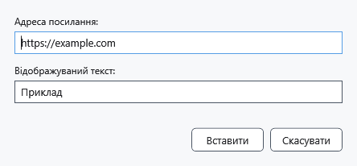

# Вебпосилання та підписи

Гіперпосилання пов'язує видимий текст із вебадресою. Для переходу всередині документа використовуйте посилання на закладку.

## Порядок дій

1. Виділіть майбутній підпис або поставте каретку. На панелі **Абзац** натисніть **Вставити гіперпосилання**.
2. У **Адреса посилання:** введіть адресу HTTP/HTTPS. Якщо схеми немає, додається https://. У **Відображуваний текст:** задайте підпис; порожній підпис замінюється адресою.
3. Натисніть **Вставити**. Перевірте підпис і перехід у режимі перегляду: зовнішнє посилання відкривається через системну програму.

## Перевірка, скасування та обмеження

**Скасувати** закриває діалог без вставлення, Ctrl+Z скасовує вставлене посилання. Некоректна адреса залишає діалог відкритим: виправте її. Цей діалог приймає вебадреси; Markdown має окремі правила. Зберігайте оформлений документ у RTF/XamlPackage та перевіряйте перехід після відкриття. Обмеження збереження закладок описано окремо.

## Пов’язані теми

- [Закладки, нотатки та внутрішні посилання](help:content.bookmarks)
- [Перегляд Markdown, посилання й зображення](help:md.preview)
