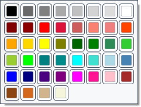

# Палітра чорнила

**Палітра чорнила** над документом дає змогу швидко застосовувати кольори тексту. Зміна кольору комірки палітри та фарбування тексту — окремі дії.

## Порядок дій

1. Виділіть текст або поставте каретку для нового введення.
2. Клацніть колір у палітрі, щоб застосувати його до тексту.
3. Щоб замінити колір однієї комірки, клацніть її правою кнопкою та виберіть колір у наборі. Потім клацніть комірку звичайним клацанням, якщо хочете застосувати новий колір.

## Перевірка, скасування та обмеження

Перевірте літери й підказку комірки. Вибір у наборі змінює налаштування палітри без автоматичного фарбування документа. Клацніть поза набором, щоб закрити його. Ctrl+Z стосується змін документа; попередній колір комірки виберіть вручну. Палітра зберігається в налаштуваннях програми та не змінює тему вікна. TXT не зберігає кольорів тексту.

## Пов’язані теми

- [Шрифт, колір і виділення](help:edit.font)
- [Оформлення програми](help:settings.appearance)
