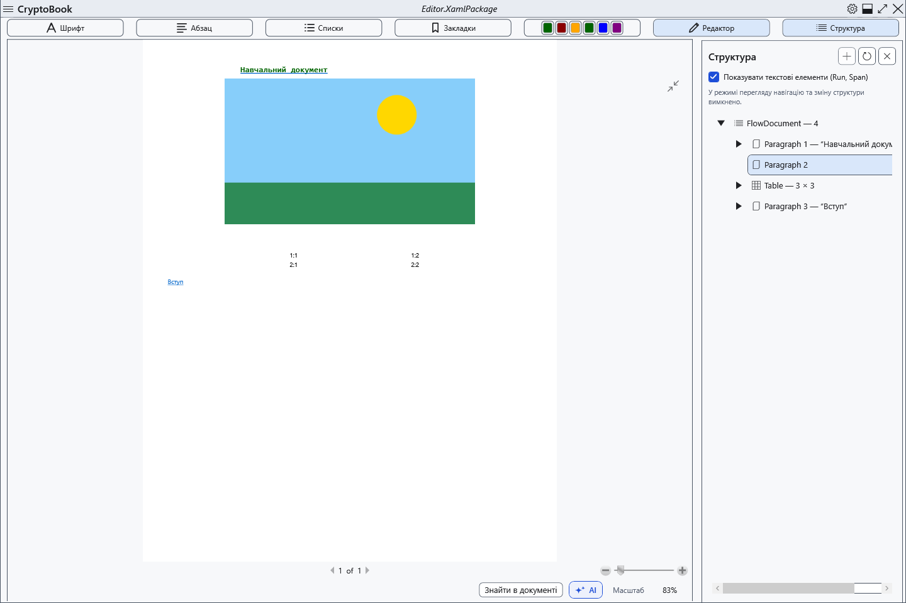

# Перегляд, сторінки й масштаб

Звичайний документ має режим редагування та посторінковий перегляд. Перегляд допомагає оцінити розташування вмісту, зберігаючи вихідний документ.

## Порядок дій

1. Над документом натисніть **Попередній перегляд**. Поверніться кнопкою **Редактор**.
2. У редакторі Ctrl+колесо миші змінює масштаб. Кнопка **100%** внизу повертає фактичний розмір; індикатор показує поточний відсоток.
3. У перегляді скористайтеся кнопкою вписування аркуша та стандартними елементами масштабу. За фокусу в переглядачі ←/PageUp і →/PageDown змінюють сторінку, Home/End переходять до першої/останньої.

## Перевірка, скасування та обмеження

Перевірте відсоток і номер сторінки; перемикання зберігає вміст. Перегляд вимикає навігацію та редагування через дерево структури: для змін поверніться до редактора. Вписування перераховується зі зміною розміру вікна. Масштаб екрана не змінює папір, шрифт у файлі чи параметри друку. Markdown має окремий перегляд без редагування результату.

## Пов’язані теми

- [Параметри й колір сторінки](help:edit.page)
- [Друк документа](help:view.print)
