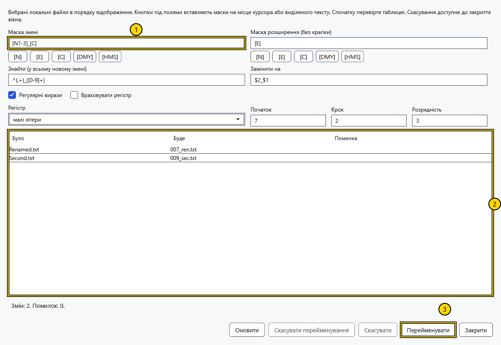
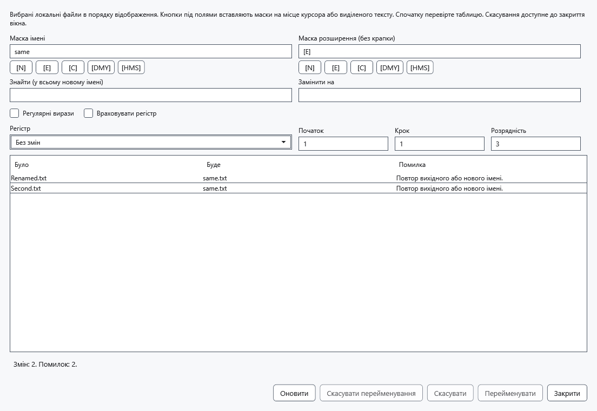
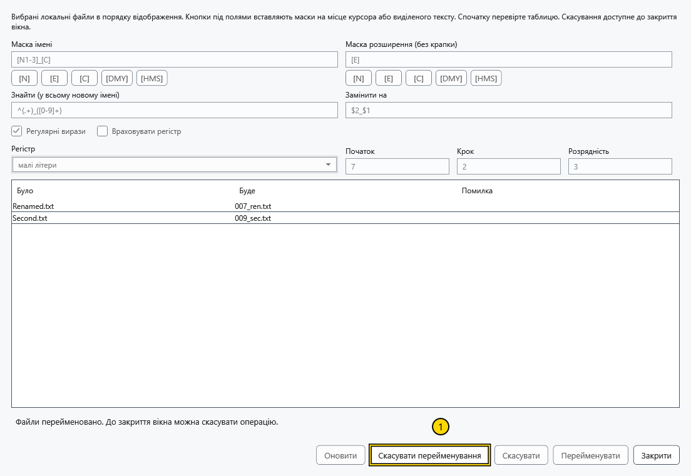

# Групове перейменування

Інструмент змінює за одним планом імена щонайменше двох локальних файлів. Папки та об’єкти Android/MTP не підтримуються. Для важливих файлів збережіть окрему копію: скасування й відновлення залежать від доступу до папок.

## Підготувати імена

1. Виділіть у менеджері два й більше локальних файлів. Спочатку відсортуйте список: лічильник дотримується видимого порядку, а не порядку виділення. Натисніть Ctrl+M, A→B або **Групове перейменування** у меню рядка. Для одного файла використовуйте звичайне перейменування.
2. Задайте **Маска імені** та **Маска розширення (без крапки)**. Кнопки токенів вставляють їх у позицію курсора чи замість виділеного тексту свого поля. Звичайний текст вводиться навколо токенів. Маска розширення задається без початкової крапки; порожня маска видаляє розширення.

На знімку: 1 — маска імені, 2 — попередній перегляд, 3 — застосування. В обох масках доступні:

| Токен | Підстановка |
| --- | --- |
| [N] / [E] | Вихідне ім’я без розширення / розширення без крапки |
| [N1-5], [N3-], [E1-2] | Символи 1–5, ім’я з третього символу, символи 1–2 розширення; позиції починаються з 1 |
| [C] | Лічильник із параметрами **Початок**, **Крок** та **Розрядність** |
| [DMY] / [HMS] | Місцеві дата ddMMyyyy / час HHmmss, узяті один раз для всього попереднього перегляду |

Наприклад, маска Photo_[C], розширення [E], початок 1, крок 1 і розрядність 3 дадуть Photo_001.jpg, Photo_002.jpg для вихідних JPG. Початок невід’ємний, крок додатний, розрядність 1–18. Діапазон за межами вихідного рядка дає порожній рядок.

3. За потреби задайте **Знайти (у всьому новому імені)** та **Замінити на**. Заміна обробляє все побудоване ім’я разом із розширенням; **Регістр** застосовується після неї. **Враховувати регістр** керує зіставленням. **Регулярні вирази** вмикає регулярні вирази .NET і групи заміни на кшталт $1. Помилковий вираз не дає отримати припустимий попередній перегляд.
4. Порівняйте **Було**, **Буде** та **Помилка** кожного рядка. Дублікати, зайняте призначення, неприпустимі й зарезервовані Windows імена блокують застосування. **Оновити** перечитує папку й оновлює дату/час токенів; виконання використовує вже показані імена.

## Застосувати й відкотити

Вибирайте **Перейменувати** лише після перевірки попереднього перегляду. Підтримуються обмін іменами та зміна лише регістру. Файли спочатку отримують тимчасові імена у своїх папках, потім остаточні; наявне призначення не перезаписується. Після успіху відповідні шляхи активного, закріплених і недавніх документів відповідають фактичному результату. Попередження запису посилань відрізняється від успіху перейменування файлів.

**Скасувати перейменування** повертає імена останньої успішної операції, доки вікно відкрите. Конфлікти перевіряються знову; новий файл на вихідному місці може блокувати відкат. Це окрема операція, не Ctrl+Z редактора. Після перевірки результату закрийте вікно.

## Скасування й помилка

До застосування закрийте вікно без змін. Під час роботи **Скасувати** або закриття запитує скасування та чекає на повернення початкових імен. За зовнішнього блокування чи зайнятого імені дані та журнал зберігаються; статус показує поточні шляхи. Після усунення перешкод або аварійного завершення відкрийте папку першого початкового файла у файловому менеджері й натисніть **Відновити операції**. Журнал у прихованій папці .cryptobook-operation-* дозволяє повторити повернення після перезапуску; наявні об’єкти не перезаписуються. Не видаляйте папки з незавершеним відновленням.

## Пов’язані теми

- [Сортування, фільтр і виділення](help:files.views)
- [Відкриття, перейменування й видалення](help:files.manage)
