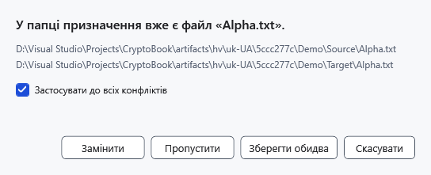

# Конфлікти імен

Конфлікт виникає, коли копіювання або переміщення займає вже наявне ім’я призначення. Перед вибором прочитайте шляхи джерела й призначення: однакові імена не означають однакового вмісту.

1. Перевірте обидва шляхи у вікні **Конфлікт імен**.
2. Виберіть дію для об’єкта:

| Рішення | Результат |
| --- | --- |
| **Замінити** | Готує нову локальну копію та зберігає попереднє призначення до завершення пакета. У разі скасування чи помилки попереднє призначення повертається. Папка замінюється цілком, а не об’єднується. |
| **Пропустити** | Залишає наявне призначення й не передає це джерело. |
| **Зберегти обидва** | Зберігає наявний об’єкт і передає джерело під вільним іменем. Перевірте фактичне нове ім’я. |
| **Скасувати** | Зупиняє планування пакета. Поки збираються рішення цих конфліктів, передавання з цього пакета ще не почалося. |

**Застосувати до всіх конфліктів** повторює вибране рішення для решти конфліктів пакета. Не встановлюйте прапорець, якщо наступним об’єктам потрібні інші рішення. Закриття вікна конфлікту означає скасування.

## Після вибору

Дочекайтеся завершення операції, оновіть список і порівняйте призначення з джерелом. Пропуск під час переміщення залишає відповідне джерело на місці. Копіювання об’єкта до його ж папки вибирає вільне ім’я копії; перенесення до вже зайнятого ним місця пропускається.

Скасування у вікні поступу повертає вже виконані дії локального пакета. Попереднє призначення зберігається до завершення передавання. Якщо поверненню заважає блокування чи зайняте ім’я, поверніть збережені дані командою **Відновити файли** у папці з журналом із повідомлення. Після аварійного завершення відкрийте папку призначення та виконайте цю команду.

## Пов’язані теми

- [Копіювання та переміщення](help:files.transfer)
- [Помилки запису](help:recovery.write)
