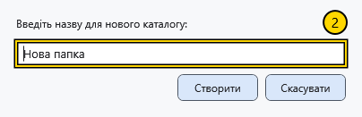

# Створити файл або папку

Створюйте об’єкти в доступній для запису папці й заздалегідь перевірте адресу. Діалог створення файла має власну папку призначення: її слід перевірити окремо.

## Створити папку

1. Перейдіть до батьківської папки й виберіть **Створити папку** на панелі або в меню тла.
2. Введіть одне ім’я папки й підтвердьте створення. **Скасувати** закриває діалог без створення.

Порожнє ім’я, роздільники шляху й неприпустимі символи відхиляються. Якщо папка з таким іменем уже існує, з’являється помилка; наявна папка не замінюється. Виправте ім’я й повторіть спробу. Переконайтеся, що нова папка з’явилася в потрібному батьківському каталозі.

## Створити файл

Виберіть **Створити файл**. У діалозі документа перевірте папку призначення, тип, ім’я та шаблон, потім підтвердьте. Створений документ відкривається в редакторі; для поточного незбереженого документа може знадобитися рішення. Формати, параметри сторінки й атрибути описано у статті про створення документа.

Недопустиме чи зарезервоване ім’я, роздільник шляху, крапка або пробіл у кінці відхиляються з повідомленням; інший файл замість запитаного не створюється. Виправте ім’я у відкритому діалозі й повторіть створення. Для зайнятого допустимого імені може вибиратися стандартне вільне ім’я: перевірте фактичні ім’я та шлях після створення.

## Діалоги вибору

Цей самий менеджер може відкритися для вибору файла або папки. Нижня кнопка підтверджує вибір, **Скасувати** повертає без вибору. Вибір папки підтверджує вказаний каталог; **Відкрити** звичайного менеджера відкриває об’єкт. Перед продовженням перевірте заголовок вікна, шлях і кнопку підтвердження.

## Пов’язані теми

- [Створити та зберегти документ](help:doc.create)
- [Конфлікти імен](help:files.conflicts)
