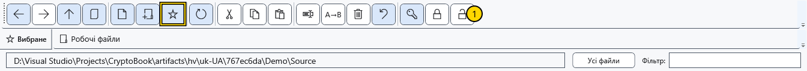

# Вибрані папки

Вибране зберігає посилання на папки файлового менеджера. Воно не копіює папку, не закріплює документ і не задає робочого каталогу пошуку.

## Додати й відкрити

1. Перейдіть до потрібної папки й натисніть зірку на панелі. Посилання з’явиться у смузі вибраного.

Натисніть посилання для переходу й перевірте адресу. Повторне додавання тієї самої папки не створює ще однієї фізичної папки. Призначення визначає шлях, а не відображувана назва посилання.

## Перейменувати або прибрати посилання

Натисніть вибрану папку правою кнопкою й виберіть **Перейменувати**. Введіть відображувану назву та збережіть; **Скасувати** відмовляється від зміни. Змінюється лише підпис вибраного, а не ім’я справжньої папки та не її шлях. Команда **Видалити з вибраного** з контекстного меню прибирає посилання: папка та вміст залишаються на диску.

## Якщо папка недоступна

Недоступне посилання відкрити не можна. Відновіть доступ до диска чи папки, потім знову відкрийте менеджер для оновлення доступності. Зміна підпису не виправляє переміщеної папки. Перейдіть до правильної папки, приберіть старе посилання й додайте поточне. Для файлів, які регулярно редагуєте, використовуйте закріплені документи.

## Пов’язані теми

- [Навігація папками](help:files.navigate)
- [Закріплені документи](help:files.pinned)
