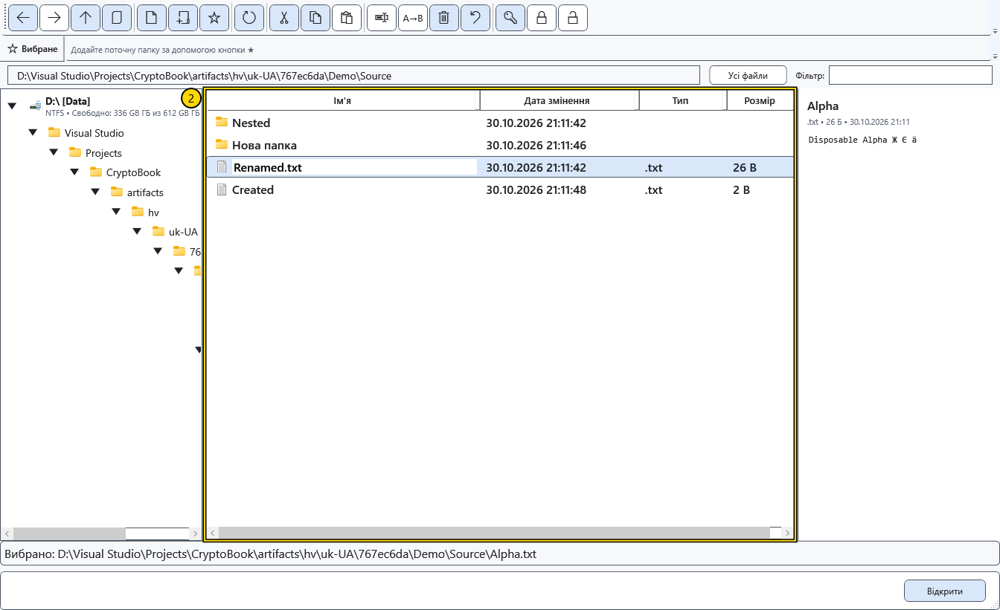

# Відкриття, перейменування й видалення

Команда використовує вибраний рядок. Перед зміною важливих файлів збережіть окрему копію. Локальне видалення запитує підтвердження та зберігає об’єкти для відновлення у CryptoBook.

## Відкрити або скопіювати шлях

Подвійне клацання папки відкриває її. Для файла виберіть **Відкрити**: підтримувані документи відкриваються в CryptoBook, інші передбачені дії можуть використовувати зовнішню програму. **Відкрити за допомогою** викликає системний вибір програми для одного локального файла. **Показати у Провіднику** показує локальний об’єкт у Провіднику Windows. Цим діям потрібні відповідний локальний об’єкт і підтримка Windows.

**Копіювати шлях** поміщає шляхи виділених об’єктів окремими рядками до буфера Windows, але не копіює вмісту файлів. Перед використанням тексту перевірте виділення та локальну адресу або адресу пристрою.

## Перейменувати один об’єкт

1. Виділіть рівно один файл чи папку й виберіть **Перейменувати**.
2. Змініть ім’я в рядку. Якщо нове розширення не вказано, попереднє зберігається автоматично. Явно введене розширення замінює попереднє. Щоб навмисно прибрати розширення, використайте групове перейменування з порожньою маскою розширення.

3. Натисніть Enter для застосування. Esc запитує підтвердження відмови від редагування; підтвердьте скасування для повернення попереднього імені. За помилки попереднє ім’я повертається й з’являється повідомлення.

Після успіху оновіть список і перевірте повний шлях. Одиночне перейменування оновлює відповідний шлях активного документа, закріплених і недавніх посилань; збій запису посилань може повідомлятися окремо. Дерево папок і зовнішні ярлики не є універсальним відстеженням документів. Для двох і більше локальних файлів є окреме групове перейменування.

## Видалити

Виділіть локальні об’єкти, виберіть **Видалити** й підтвердьте вибір. **Скасувати** у підтвердженні залишає файли на місці. Скасування операції повертає локальний пакет; якщо повернення заблоковане, повідомлення вкаже збережені дані.

Для повернення після завершеного видалення відкрийте початкову папку й натисніть **Відновити файли** на панелі. Для виділення з різних папок журнал міститься поряд із першим початковим об’єктом. Команда працює й після перезапуску, повертає файли та папки цілком і не перезаписує зайняті імена. Закрийте програми, що заважають, або звільніть початкове ім’я та повторіть відновлення.

Об’єкти зберігаються у прихованих папках .cryptobook-operation-* поряд з оригіналами та займають місце до повернення або явного видалення цих папок. Їх видалення через Провідник робить видалення остаточним. Кошик Windows та історія редактора тут не використовуються. Для Android та інших віддалених джерел лишається окреме попередження про незворотне видалення.

## Пов’язані теми

- [Групове перейменування](help:files.batch)
- [Можливості й обмеження джерел](help:devices.limits)
- [Два редактори, перейменування та закриття](help:doc.switch)
