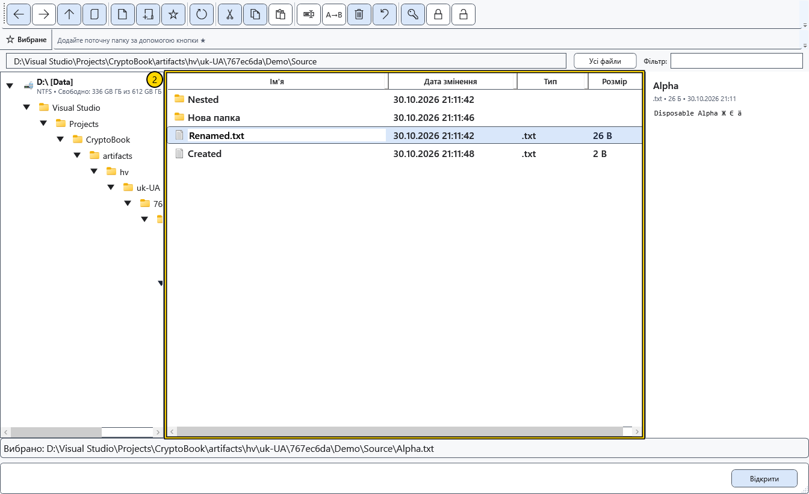

# Відкриття, перейменування й видалення

Команда використовує вибраний рядок. Перед зміною важливих файлів збережіть окрему копію. Перед локальним видаленням перевіряється вільний обсяг кошика та запитується підтвердження вибраного способу видалення.

## Відкрити або скопіювати шлях

Подвійне клацання папки відкриває її. Для файла виберіть **Відкрити**: підтримувані документи відкриваються в CryptoBook, інші передбачені дії можуть використовувати зовнішню програму. **Відкрити за допомогою** викликає системний вибір програми для одного локального файла. **Показати у Провіднику** показує локальний об’єкт у Провіднику Windows. Цим діям потрібні відповідний локальний об’єкт і підтримка Windows.

**Копіювати шлях** поміщає шляхи виділених об’єктів окремими рядками до буфера Windows, але не копіює вмісту файлів. Перед використанням тексту перевірте виділення та локальну адресу або адресу пристрою.

## Перейменувати один об’єкт

1. Виділіть рівно один файл чи папку й виберіть **Перейменувати**.
2. Змініть ім’я в рядку. Якщо нове розширення не вказано, попереднє зберігається автоматично. Явно введене розширення замінює попереднє. Щоб навмисно прибрати розширення, використайте групове перейменування з порожньою маскою розширення.

3. Натисніть Enter для застосування. Esc запитує підтвердження відмови від редагування; підтвердьте скасування для повернення попереднього імені. За помилки попереднє ім’я повертається й з’являється повідомлення.

Після успіху оновіть список і перевірте повний шлях. Одиночне перейменування оновлює відповідний шлях активного документа, закріплених і недавніх посилань; збій запису посилань може повідомлятися окремо. Дерево папок і зовнішні ярлики не є універсальним відстеженням документів. Для двох і більше локальних файлів є окреме групове перейменування.

## Видалити

Виділіть локальні об’єкти та виберіть **Видалити**. Спочатку програма підрахує обсяг усього вибраного набору та порівняє його з вільним лімітом кошика на кожному диску. Якщо місця достатньо, підтвердьте переміщення до кошика Windows. Якщо весь набір не вміщується або кошика немає, окреме попередження запропонує незворотно видалити **всі вибрані об’єкти**. До підтвердження нічого не видаляється; **Скасувати** залишає весь набір на місці. Якщо ліміт кошика неможливо визначити, операція зупиняється з повідомленням. Програма самостійно не очищає старі об’єкти з кошика.

Для повернення відкрийте **Кошик** Windows, виділіть потрібні об’єкти й виберіть **Відновити**. Вони повернуться до початкових папок. Якщо скасувати вже розпочате видалення кількох об’єктів або станеться помилка, частина об’єктів може бути в кошику, решта лишається на місці. Об’єкти з кошика повертаються його засобами. Після очищення кошика або остаточного видалення з нього звичайне відновлення недоступне.

Для Android та інших віддалених джерел діє окреме попередження про незворотне видалення. У змішаному виділенні локальні об’єкти йдуть до кошика, а віддалені обробляються за правилами пристрою.

## Відновити перервані операції

Кнопка **Відновити операції** на панелі доступна лише за наявності незавершеного журналу у відкритій папці. Вона недоступна під час відновлення та вимикається після успішного завершення. Журнали перевіряються під час переходу до папки, оновлення списку та завершення файлової операції. Для перерваного передавання відкрийте папку призначення; для групового перейменування — папку першого початкового файла. Файли з кошика Windows ця кнопка не повертає.

Якщо попередня збірка зберегла видалені об’єкти в сусідній папці відновлення, їх як і раніше можна повернути цією кнопкою з папки зі старим журналом.

## Пов’язані теми

- [Групове перейменування](help:files.batch)
- [Можливості й обмеження джерел](help:devices.limits)
- [Два редактори, перейменування та закриття](help:doc.switch)
