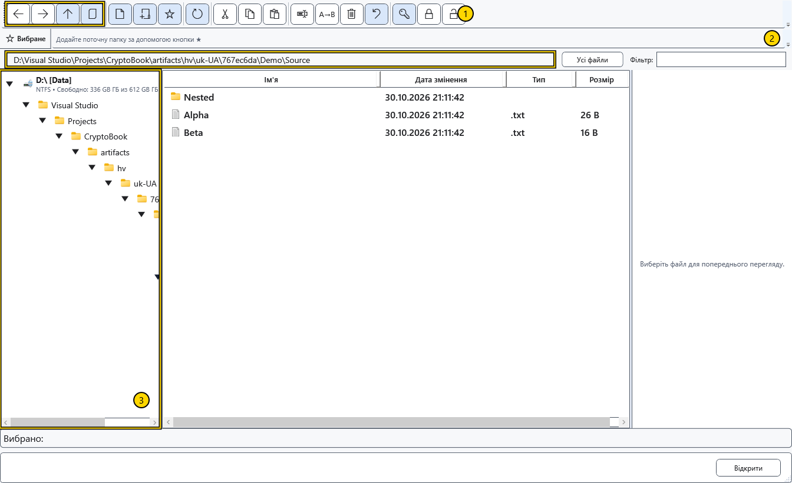
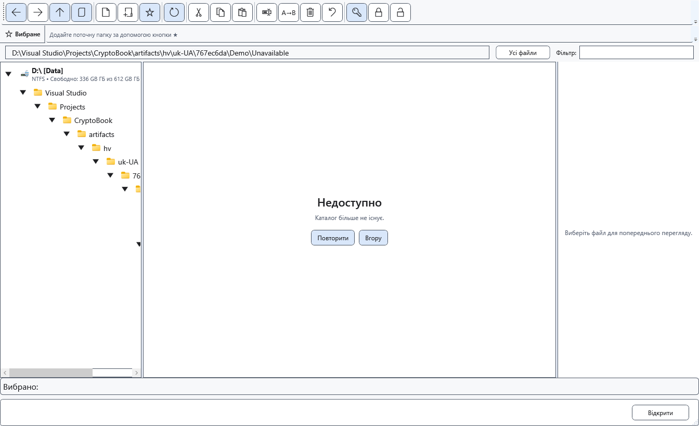

# Навігація папками

Файловий менеджер має власну поточну папку й історію переходів. Перегляд папок не змінює робочого каталогу пошуку та документа, вже відкритого в редакторі.

## Вибрати папку

1. Відкрийте файловий менеджер із меню документів. Виберіть диск і папку в дереві ліворуч; розгортайте гілку стрілкою. Подвійне клацання папки у списку відкриває її.
2. Можна ввести повний локальний шлях папки в адресному рядку й натиснути Enter. Esc повертає поточну адресу без переходу.
3. Стрілки панелі ведуть назад, уперед і до батьківської папки. **Показати поточний документ** переходить до папки документа зі збереженим шляхом. **Оновити** перечитує поточну папку.

На знімку: 1 — кнопки переходів, 2 — адреса, 3 — дерево папок. Перевіряйте адресу перед створенням, вставленням і видаленням. Вибрана папка дерева й виділені файли списку використовуються різними командами.

## Якщо папка недоступна

Замість списку може з’явитися панель недоступної папки. Перевірте шлях, підключення диска й дозволи, відновіть доступ і натисніть кнопку повторної спроби. Можна також перейти до доступної батьківської папки. Порожній або недоступний список не доводить видалення файлів.

Закрийте менеджер, щоб повернутися до документа. Закриття не скасовує завершених файлових операцій. Адреси й можливості пристроїв відрізняються від локальних шляхів; адресу пристрою не можна вважати звичайним шляхом Windows.

## Пов’язані теми

- [Вибрати робочу директорію](help:start.workspace)
- [Пристрої Android](help:devices.android)
- [Сортування, фільтр і виділення](help:files.views)
