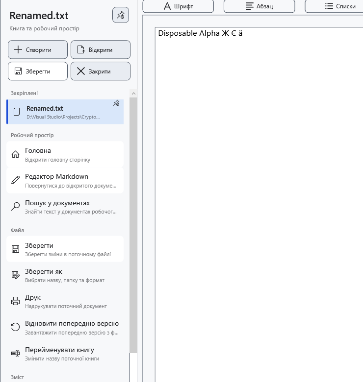

# Закріплені документи

Закріпіть документ, щоб зберегти посилання на його файл у бічному меню. Закріплення не зберігає правок і не створює резервної копії. Документу потрібен придатний збережений шлях.

1. Відкрийте документ і розгорніть бічне меню. У швидких діях виберіть **Закріпити поточний документ**. Файл з’явиться в розділі **Закріплені**; та сама кнопка стане **Відкріпити поточний документ**.

Натисніть закріплений файл для відкриття. Поточний документ і незбережений стан позначаються окремо від доступності. Відкриття іншого документа може запитати рішення про незбережені правки; відмова від перемикання зберігає поточний документ.

## Керувати списком

Натисніть запис правою кнопкою. **Перемістити вище** і **Перемістити нижче** змінюють лише порядок посилань. **Показати у Провіднику** показує локальний файл у Windows. Відкриття контекстного меню оновлює доступність. **Відкріпити** видаляє лише посилання, залишаючи файл на місці.

## Знайти переміщений файл

Якщо файла немає, спочатку підключіть його диск. Для справді переміщеного файла виберіть **Указати нове розташування…** та вкажіть наявне нове розташування; скасування вибору зберігає попереднє посилання. Це виправлення посилання без перенесення файла. Перевірте ім’я та вміст, щоб не прив’язати сторонній файл.

Одиночне й групове перейменування в менеджері оновлює відповідні шляхи поточного, закріплених і недавніх документів. За попередження запису посилань перевірте фактичний шлях на диску та виправте посилання. Довільне зовнішнє переміщення не слід вважати автоматично відстежуваним.

## Пов’язані теми

- [Останні документи](help:files.recent)
- [Два редактори, перейменування та закриття](help:doc.switch)
