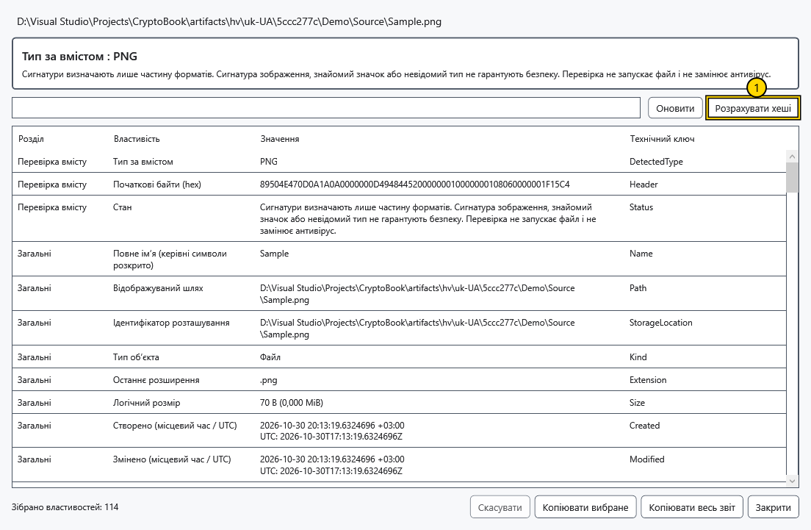
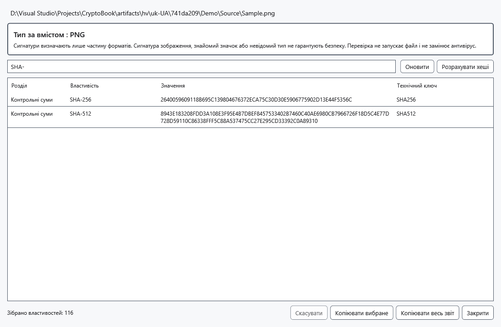

# Докладні властивості й хеші

Докладний звіт досліджує вибраний об’єкт без його виконання. Він допомагає порівняти файли й помітити невідповідність імені вмісту. Розпізнаний формат або дійсний підпис не гарантують нешкідливості вмісту.

1. Виділіть один файл і виберіть **Докладні властивості** у контекстному меню або натисніть Alt+Enter з фокусом у списку файлів. Для папки є команда контекстного меню. **Властивості** — окрема дія властивостей Windows.
2. Дочекайтеся завершення читання. Виявлений тип визначається за підтримуваними заголовками файла, а не лише розширенням. Невідомі формати й помилки розділів показуються без втрати решти доступних відомостей.

Позначена кнопка запускає розрахунок хешів. Для локального файла звіт може включати розмір, місцеві/UTC-дати, атрибути, ціль посилання, зайняте місце, ідентифікатори тому/файла, жорсткі посилання, власника та збережені правила доступу. Правила не є обчисленням ваших ефективних дозволів. Потоки NTFS і обмежений текст Zone.Identifier, значення Windows Property System, медіа/EXIF і властивості документів залежать від файлової системи, обробників і прав.

Для підтримуваних виконуваних файлів читаються версія, відомості PE/CLR та підписи без завантаження файла як програми. Підписи перевіряються за локально доступними відомостями без мережевого оновлення відкликання; дані сертифіката й результат довіри розділено. Виявлення ZIP/OLE означає контейнер, а не безпеку його вмісту. Зашифрований .cbook розглядається як контейнер без автоматичного розшифрування.

Назви від обробників властивостей Windows можуть відповідати мові Windows; технічні ключі та збережені значення показано як отримано.

## Хеші й копіювання

3. Натисніть **Розрахувати хеші** для SHA-256 і SHA-512 за один прохід. Порівнюйте значення повністю з довіреним еталоном саме цього файла. **Скасувати** зупиняє роботу кооперативно; поточний нативний виклик Windows може завершитися пізніше. Файл, у який записують або який змінився під час читання, може дати помилку; закрийте програму запису й повторіть.

Введіть частину розділу, назви, значення чи технічного ключа в поле пошуку. Очистьте його для всіх рядків. Виділіть рядки з Ctrl/Shift і натисніть **Копіювати вибране** або **Копіювати весь звіт** для всіх зібраних властивостей навіть за фільтра. **Оновити** перечитує властивості; після цього розрахуйте хеші знову. Закрийте вікно для повернення без зміни досліджуваного файла.

Віддалені джерела дають лише доступні метадані об’єкта. Повна перевірка вмісту, Windows/NTFS-відомості, підписи й хеші потребують локальної копії. Відсутність полів може відображати обмеження формату, обробника чи доступу; звіт не є антивірусом та універсальним переліком усіх внутрішніх полів будь-якого формату.

## Пов’язані теми

- [Можливості й обмеження джерел](help:devices.limits)
- [Сумісність захищених файлів](help:security.compatibility)
