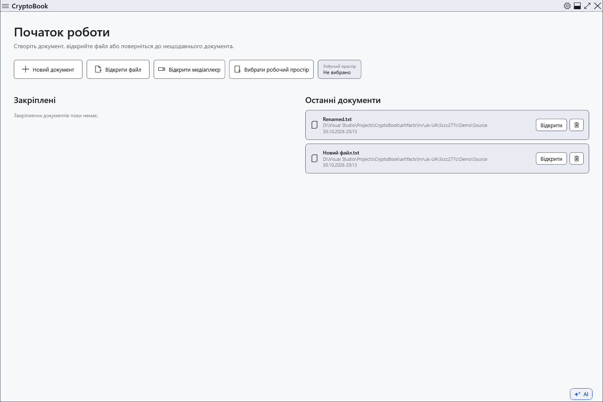

# Останні документи

Початковий екран показує документи після успішного відкриття чи збереження. Це історія посилань на файли, а не збережені копії та не архів вмісту документів.

1. Закрийте поточний документ, прийнявши рішення про незбережені правки, щоб повернутися до початкового екрана. Знайдіть розділ **Останні документи**.

Натисніть недавній документ для відкриття його поточного файла. Перевірте ім’я й батьківську папку, особливо за однакових імен. Запис історії не гарантує, що диск підключено й вихідний файл існує.

## Недоступні й переміщені файли

Спочатку підключіть диск. Для переміщеного файла виберіть **Знайти…** та вкажіть наявне нове розташування. Скасування вибору зберігає попереднє посилання. Новий шлях оновлює посилання, але не відновлює видаленого вмісту й не переносить файла. Закріплені й недавні — різні списки, тому під час ручного виправлення перевірте обидва.

**Видалити з історії** прибирає непотрібний запис. Фізичний файл залишається; успішне відкриття чи збереження може знову додати його до історії. Видалення запису не є видаленням документа. Для списку швидкого доступу, який ви підтримуєте самі, закріпіть документ у бічному меню.

Якщо історію не вдалося оновити, відкритий файл і збережене посилання — окремі результати. Перевіряйте фактичний шлях і повідомлення операції: старий запис сам собою не доводить помилки збереження файла.

## Пов’язані теми

- [Закріплені документи](help:files.pinned)
- [Відкрити документ](help:doc.open)
