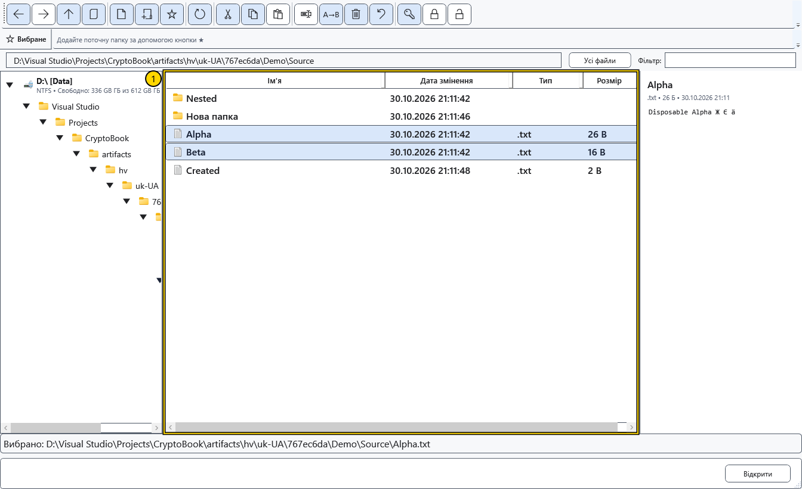
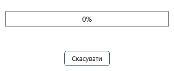

# Копіювання та переміщення

Ці кроки стосуються локальних файлів і папок. Перед перенесенням важливих даних збережіть окрему копію та перевірте джерело й призначення. У разі скасування або помилки CryptoBook повертає зміни локального пакета за журналом.

1. Виділіть вихідні рядки за допомогою Ctrl або Shift. Виберіть **Копіювати** для збереження оригіналів або **Вирізати** для перенесення. Команди запам’ятовують файлову операцію всередині CryptoBook; **Копіювати шлях** окремо копіює текст до буфера Windows.

2. Перейдіть до папки призначення й виберіть **Вставити**. Інший шлях — **Перемістити** для вихідного виділення та вибір призначення в діалозі папки; скасування вибору залишає файли на місці. Розв’яжіть конфлікти імен до початку передавання.
3. Дочекайтеся завершення вікна поступу. **Скасувати** або закриття вікна запитує скасування; вікно залишається до зупинки роботи й оновлення списку.

Можна перетягнути виділення на папку призначення в дереві або списку. Утримання Ctrl запитує копіювання, без Ctrl — переміщення. Перевірте ціль перед відпусканням. Папку не можна перемістити в себе або нащадка; корінь диска не є звичайним об’єктом для перенесення.

## Перевірити результат

Оновіть призначення й відкрийте приклад скопійованого файла. Після переміщення перевірте і призначення, і джерело. Успішне вставлення після вирізання очищує запам’ятоване перенесення. Не вважайте, що переміщення оновлює всі збережені посилання на документ: одиночне й групове перейменування мають власне оновлення шляхів.

## Скасування й помилки

Скасування або помилка запускає повернення всього локального пакета, включно з уже переданими елементами та попередніми призначеннями. Під час перенесення між томами копія перевіряється до видалення збереженого джерела. Якщо зайняте ім’я чи зовнішнє блокування заважає поверненню, дані та журнал зберігаються; повідомлення вкаже папку журналу. Усуньте перешкоду, відкрийте цю папку й натисніть **Відновити файли**. Після аварійного завершення використайте цю ж команду в папці призначення. Успішно завершене передавання окремого відкату не зберігає. Передавання з пристроями має власні правила.

## Пов’язані теми

- [Конфлікти імен](help:files.conflicts)
- [Передавання на пристрої](help:devices.transfers)
