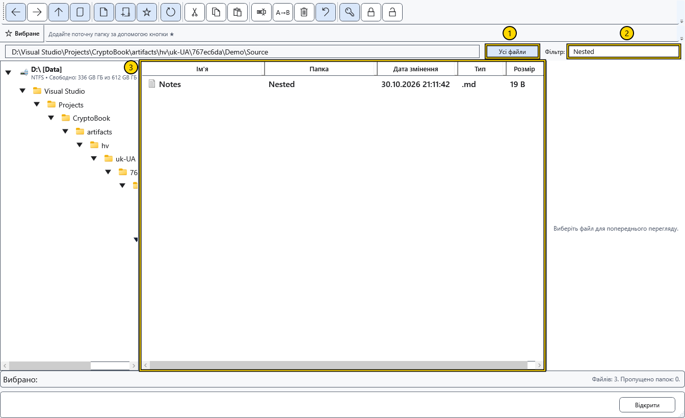

# Сортування, фільтр і виділення

Налаштуйте список перед вибором файлів для операції. Фільтр змінює видимість рядків, але нічого не переміщує й не видаляє.

## Налаштувати подання

Натисніть заголовок стовпця для сортування; повторне натискання змінює напрямок. Доступні ім’я, дата зміни, тип і розмір. Межа заголовка змінює ширину стовпця. Вертикальні роздільники змінюють ширину дерева, списку та області перегляду.

Увімкніть **Усі файли**, щоб отримати файли поточної папки й усіх вкладених папок. Додатковий стовпець папки показує відносне розташування; самі папки не стають рядками цього режиму. Під час вибору папки в діалозі режим недоступний.

На знімку: 1 — рекурсивний режим, 2 — фільтр, 3 — список. Введіть текст у **Фільтр:**: він зіставляється з іменем, включно з розширенням, а в рекурсивному режимі — ще й з відносною папкою. Очистьте поле, щоб повернути список. Це фільтр за підрядком, а не пошук у вмісті документів.

## Читання й виділення

Рядок стану показує читання, кількість файлів і пропущених папок. Кнопка скасування читання зупиняє обхід великого дерева; список після цього може бути неповним. Оновіть його для нової спроби або вимкніть **Усі файли** для повернення до поточної папки. Пропущені й недоступні папки не означають порожнього джерела.

Клацання виділяє один об’єкт, Ctrl із клацанням — окремі рядки, Shift із клацанням — діапазон. Перед командою перевірте підсвічені рядки: контексти дерева, тла й рядка мають різні цілі. Лічильник групового перейменування дотримується видимого порядку файлів, а не порядку клацань.

## Пов’язані теми

- [Навігація папками](help:files.navigate)
- [Групове перейменування](help:files.batch)
- [Пошук файлів за іменем](help:search.name)
