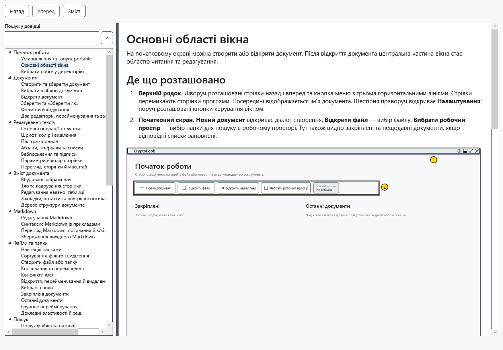
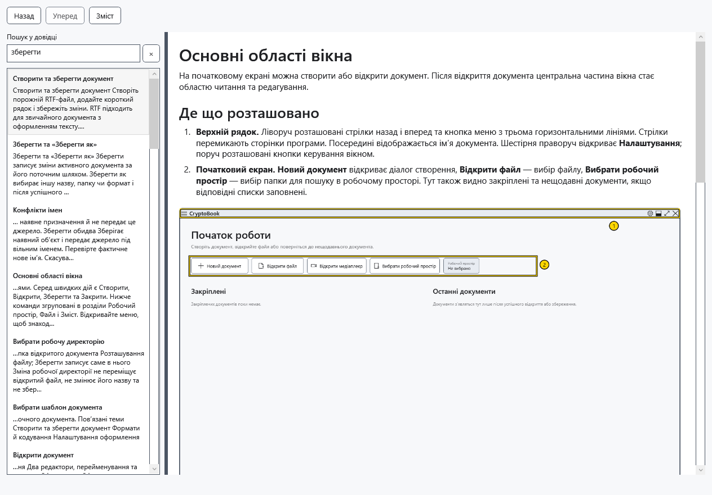
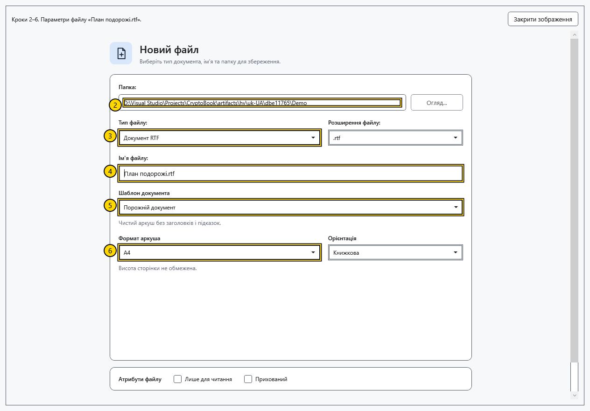

# Зміст, пошук та ілюстрації довідки

Вбудована довідка доступна без мережі й відкритого документа. Вона відкривається окремим немодальним вікном: можна повернутися до роботи, залишивши статтю відкритою.

## Відкрити тему

1. Виберіть **Довідка** у бічному меню головного вікна або натисніть **F1** у головному вікні. Повторний виклик активує наявне вікно, зокрема згорнуте.
2. Ліворуч розгорніть розділ і виберіть статтю. Роздільник між змістом і текстом змінює ширину областей; статтю можна прокручувати.

## Знайти та повернутися

3. Введіть слова в **Пошук у довідці** або натисніть Ctrl+F. Пошук враховує заголовки, ключові слова й текст статей поточною мовою, вимагає всіх слів і не шукає ваші документи.
4. Клацніть результат або виберіть його й натисніть Enter. Якщо результатів немає, скоротіть запит або спробуйте інше слово.

5. **Зміст** та **×** очищують запит і повертають дерево; вони не відкривають першу статтю. **Назад / Уперед** або Alt+←/→ переміщують історією тем і відновлюють місце читання. Нова гілка переходів замінює попередню історію вперед.

## Збільшити зображення

6. Клацніть ілюстрацію або перейдіть до її кнопки клавішею Tab і натисніть Enter. Великий знімок можна прокручувати.

7. Натисніть **Закрити зображення** або Esc. У полі пошуку Esc спочатку очищує запит, а за порожнього запиту переводить фокус до статті. Закрийте вікно його хрестиком або Alt+F4.

Остання тема й розміри вікна зберігаються; історія переходів існує лише до закриття. Зміна мови відкриває переклад тієї самої теми, очищує запит і скидає прокручування. Довідка Markdown із редактора веде до теми синтаксису в цьому самому вікні. Якщо зображення недоступне, використовуйте текст кроків і повідомте версію програми; окреме завантаження зображень для звичайної роботи не потрібне.

- [Основні області вікна](help:start.interface)
- [Мова програми](help:settings.language)
- [Редактор Markdown](help:md.edit)
- [Гарячі клавіші](help:settings.hotkeys)
