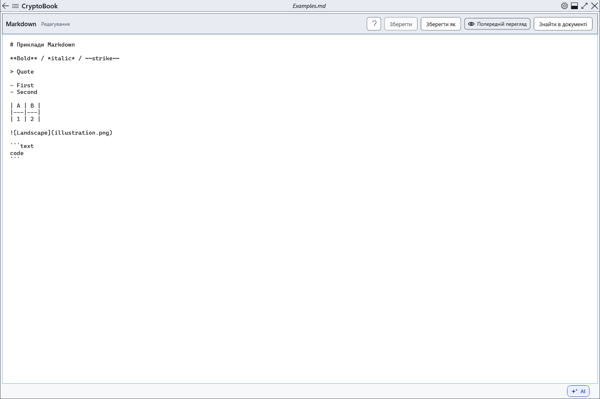

# Редагування Markdown

Markdown — окремий текстовий документ із розміткою. Він може залишатися відкритим разом зі звичайним документом; файлові команди стосуються вибраного редактора.

## Порядок дій

1. Відкрийте .md або створіть Markdown-документ. Вводьте розмітку у вихідному полі. Tab вставляє табуляцію, Ctrl+Z скасовує введення в цьому полі.
2. Натисніть **Попередній перегляд**, щоб побачити результат. **Редактор** повертає до вихідного тексту. Для зміни результату виправляйте розмітку.
3. Кнопка довідки відкриває статтю про синтаксис в окремому немодальному вікні. Основний редактор і обидва документи залишаються на місці. Закрийте довідку кнопкою закриття або Alt+F4, коли вона має фокус.

## Перевірка, скасування та обмеження

Зберігайте через **Зберегти** або Ctrl+S; Ctrl+Shift+S вибирає інший файл. Перевірте вихідний текст після відкриття. Перегляд щоразу створюється з поточного тексту без зворотного перетворення в Markdown. Панелі звичайного редактора його не форматують. Перемикання сторінок не означає збереження: враховуйте незбережені зміни перед закриттям.

## Пов’язані теми

- [Синтаксис Markdown із прикладами](help:md.syntax)
- [Збереження вихідного Markdown](help:md.save)
- [Два редактори, перейменування та закриття](help:doc.switch)
