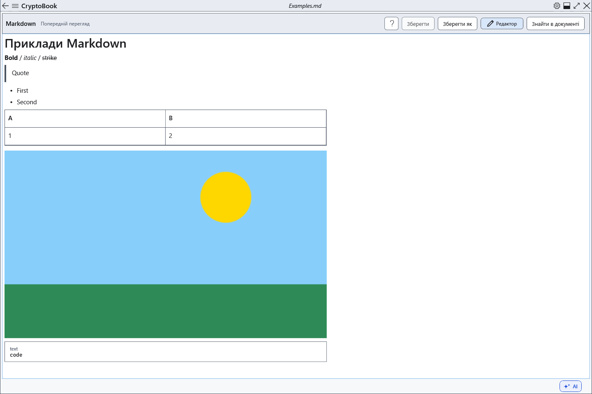

# Перегляд Markdown, посилання й зображення

Перегляд показує оформлену копію поточного Markdown. Змінюйте вихідний текст, а не відображений результат.

## Порядок дій

1. Натисніть **Попередній перегляд**. Заголовки, списки, код і таблиці будуються з тексту. Після правки знову відкрийте перегляд для оновлення.
2. Вебпосилання HTTP/HTTPS та mailto можуть відкриватися через системні програми. Відносні посилання на документи, file: та ftp: не активуються.
3. Покладіть зображення поруч із .md або в підпапку й введіть ``. Дозволені лише локальні відносні шляхи, файл до 25 МіБ; декодування обмежене 1600 пікселями. Мережеві та абсолютні шляхи зображень не завантажуються.

## Перевірка, скасування та обмеження

HTML залишається неактивним текстом. Якщо замість зображення видно підпис, перевірте шлях відносно Markdown, наявність і розмір файла. Переносьте обидва файли разом. **Редактор** повертає збережений вихідний текст. Не розраховуйте на спеціальне оформлення непідтримуваних розширень: завдання, виноски й формули не стають повноцінними інтерактивними елементами чи обчисленнями.

## Пов’язані теми

- [Синтаксис Markdown із прикладами](help:md.syntax)
- [Пошук у документі](help:search.document)
