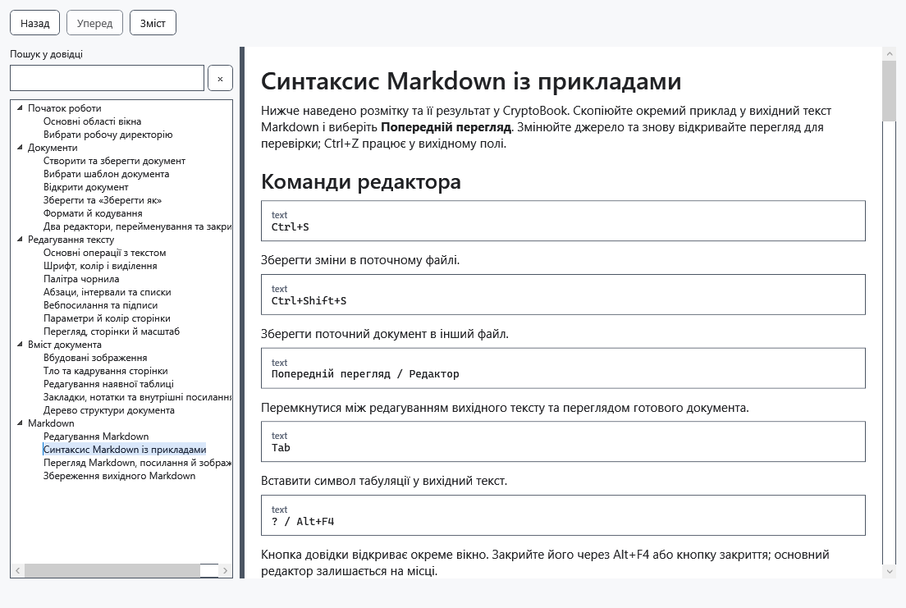

# Синтаксис Markdown із прикладами

Нижче наведено розмітку та її результат у CryptoBook. Скопіюйте окремий приклад у вихідний текст Markdown і виберіть **Попередній перегляд**. Змінюйте джерело та знову відкривайте перегляд для перевірки; Ctrl+Z працює у вихідному полі.

## Команди редактора

````text
Ctrl+S
````

Зберегти зміни в поточному файлі.

````text
Ctrl+Shift+S
````

Зберегти поточний документ в інший файл.

````text
Попередній перегляд / Редактор
````

Перемкнутися між редагуванням вихідного тексту та переглядом готового документа.

````text
Tab
````

Вставити символ табуляції у вихідний текст.

````text
? / Alt+F4
````

Кнопка довідки відкриває окреме вікно. Закрийте його через Alt+F4 або кнопку закриття; основний редактор залишається на місці.

## Заголовки та роздільники

````text
# H1
## H2
…
###### H6
````

ATX-заголовки рівнів 1–6. Наприкінці можна додати таку саму кількість символів #.

````text
Heading 1
=========
````

Setext-заголовок першого рівня.

````text
Heading 2
---------
````

Setext-заголовок другого рівня.

````text
---
***
___
````

Горизонтальний роздільник із трьох або більше символів -, * чи _.

## Списки та цитати

````text
> quote
>> nested
````

Блок цитати. Додаткові символи > створюють вкладені цитати.

````text
- item
+ item
* item
````

Маркований список; маркером може бути -, + або *.

````text
1. item
2) item
````

Нумерований список із . або ) після числа. Перше число задає початок нумерації.

````text
- parent
    - child
````

Відступ створює вкладений список. У пункти можна вкладати абзаци, цитати, код та інші списки.

## Форматування всередині рядка

````text
*italic*
_italic_
````

Курсивний текст.

````text
**bold**
__bold__
````

Напівжирний текст.

````text
***bold italic***
````

Напівжирний курсив. Замість трьох зірочок можна використати три підкреслення.

````text
~~strike~~
````

Закреслений текст.

````text
`code`
``code with ` inside``
````

Фрагмент коду моноширинним шрифтом. Якщо всередині є зворотна лапка, використовуйте довший обмежувач.

````text
\*literal asterisks\*
````

Зворотна коса риска показує службовий символ буквально, не застосовуючи розмітку.

````text
&copy;
&#169;
````

Іменована або числова HTML-сутність, що перетворюється на символ Unicode.

## Абзаци та перенесення рядків

````text
text

text
````

Порожній рядок починає новий абзац.

````text
text
text
````

Звичайне переведення рядка у вихідному тексті відображається як пробіл у тому самому абзаці.

````text
text  ⏎
text
````

Два пробіли в кінці рядка вставляють перенесення без створення нового абзацу.

````text
text\
text
````

Зворотна коса риска в кінці рядка також вставляє примусове перенесення.

## Посилання та зображення

````text
[text](https://example.com)
````

Активне HTTP-, HTTPS- або поштове посилання.

````text
[text][ref]

[ref]: https://example.com
````

Посилання, URL якого оголошено окремо. Також підтримуються скорочені форми [text][] і [ref].

````text
<https://example.com>
````

Вебадреса без окремого підпису, що відображається як активне посилання.

````text
<name@example.com>
````

Адреса електронної пошти, що перетворюється на активне посилання mailto.

````text
https://example.com
````

Звичайна HTTP- або HTTPS-адреса розпізнається автоматично.

````text

````

Зображення поруч із Markdown-файлом або у відносній вкладеній папці.

````text
![alt][image]

[image]: images/picture.png
````

Локальне зображення, відносний шлях до якого оголошено у визначенні посилання.

## Блоки коду

````text
```csharp
code
```
````

Огороджений блок коду. Текст після початкової огорожі показується як назва мови; підсвічування синтаксису немає.

````text
~~~text
code
~~~
````

Огороджений блок коду з трьох або більше тильд замість зворотних лапок.

````text
    indented code
````

Блок коду, створений відступом кожного рядка на чотири пробіли або одну табуляцію.

## Таблиці

````text
| A | B |
|---|---|
| 1 | 2 |
````

Таблиця з вертикальними рисками. Рядок-роздільник створює заголовок; крайні риски необов’язкові.

````text
+---+---+
| A | B |
+===+===+
| 1 | 2 |
+---+---+
````

Сіткова таблиця. Символ = позначає межу заголовка; підтримується об’єднання рядків і стовпців.

## Обмеження попереднього перегляду

````text
<b>HTML</b>
````

HTML-код показується як неактивний вихідний текст і ніколи не виконується.

````text
[file](file:///…)
[ftp](ftp://…)
[relative](relative.md)
````

FTP, file, відносні, javascript- та інші посилання поза HTTP відображаються як текст, а не як активні посилання.

````text

````

Віддалені зображення та зображення за абсолютним шляхом не завантажуються; замість них показується альтернативний текст.

````text
- [x] task
[^1] footnote
$math$
````

Усю розмітку зі спеціальним відображенням перелічено вище. Інші розширення Markdig — прапорці завдань, виноски, формули, діаграми, списки визначень, попередження, контейнери, медіавставки, скорочення, вставлений і виділений текст, нижні й верхні індекси — не мають відповідного оформлення.




## Перевірка, скасування та обмеження

H1…H6 позначають рівні заголовків: замість рядка з трикрапкою введіть потрібну кількість #. Слово code позначає вміст блока, а не виконувану команду. Пробіли й порожні рядки впливають на результат: для жорсткого переносу потрібні два кінцеві пробіли або зворотна скісна риска. Якщо оформлення не з'явилося, порівняйте знаки й відступи з прикладом. Перегляд не виконує код чи HTML. Зберігайте .md, щоб залишити саму розмітку.

У прикладі переносу ⏎ позначає кінець рядка: не вводьте сам знак, залиште перед переводом рядка два пробіли.

## Пов’язані теми

- [Перегляд Markdown, посилання й зображення](help:md.preview)
- [Редагування наявної таблиці](help:content.tables)
